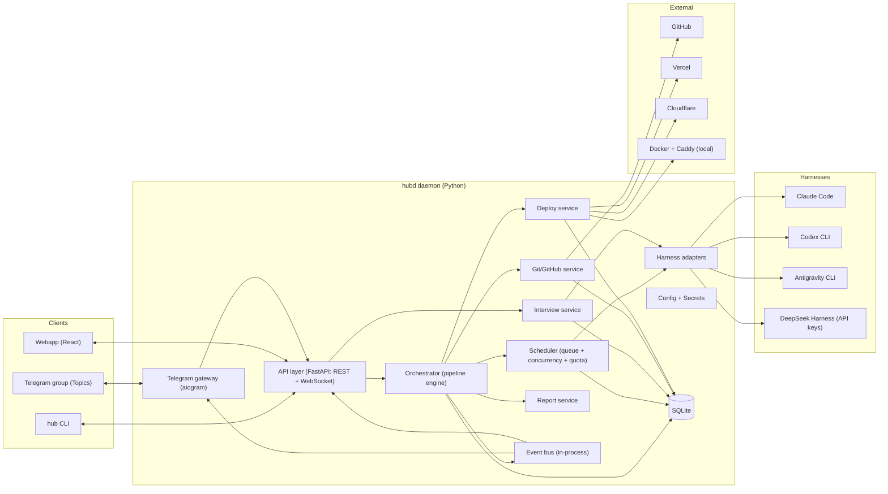
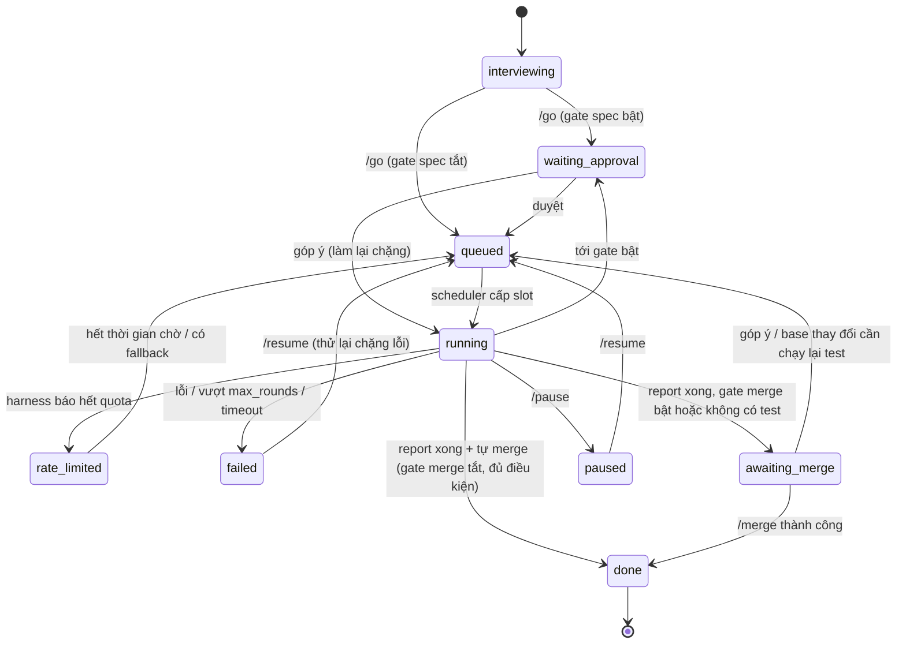

# ARCHITECTURE — ntc-ai-center-hub

> Phiên bản: 0.1 (draft) · Ngày: 2026-10-24 · Đi kèm: [PRD.md](./PRD.md)
> Ký hiệu: **[Owner]** chủ dự án quyết · **[Đề xuất]** người viết đề xuất · **[Builder]** người xây dựng tự quyết · **[Cần xác minh]** dữ kiện về công cụ bên ngoài cần kiểm tra lại khi bắt đầu code.

---

## 1. Nguyên tắc kiến trúc
1. **Một bộ não, nhiều cửa vào.** Toàn bộ logic nằm trong daemon `hubd`. Telegram, `hub` CLI, Webapp là client mỏng gọi chung một API [Owner: 3 kênh; Đề xuất: cách tổ chức].
2. **Hub điều phối, harness làm việc.** Hub không tự sinh code; nó gọi harness (Claude Code / Codex / Antigravity / DeepSeek Harness) **chỉ qua CLI chính chủ** ở chế độ headless [Owner].
3. **Artifact là hợp đồng giữa các chặng.** Các agent khác harness trao đổi qua file (`spec.md`, `plan.md`, `review.json`…), không qua bộ nhớ riêng của harness.
4. **Hub giữ quyền ghi lên GitHub, agent thì không.** Đây là cơ chế chính để đảm bảo anti-goal "không push hỏng repo".
5. **Lưu bền, chạy lại được.** Mọi chuyển trạng thái ghi vào SQLite trước khi thực hiện tác dụng phụ.
6. **Cài một máy, không phụ thuộc hạ tầng ngoài** (không Redis, không Postgres) cho v1.

---

## 2. Tổng quan hệ thống



---

## 3. Công nghệ [Đề xuất]

| Thành phần | Lựa chọn | Lý do |
|---|---|---|
| Ngôn ngữ lõi | **Python 3.12+**, asyncio | Mọi harness được gọi qua CLI (subprocess) nên ngôn ngữ trung lập; Python mạnh về subprocess/async, dễ viết script vận hành. (Ban đầu chọn vì SDK Antigravity chỉ có Python — nay hub không dùng SDK, lý do này không còn; TypeScript cũng là lựa chọn hợp lệ.) |
| API | FastAPI + Uvicorn, WebSocket cho log/stream | async, OpenAPI tự sinh cho CLI/Web |
| Telegram | aiogram 3 | hỗ trợ forum topics (`message_thread_id`), inline keyboard, long-polling |
| CLI | Typer + Rich (+ Textual cho `attach`) | |
| Webapp | React + Vite + TypeScript, build tĩnh, `hubd` phục vụ | |
| Lưu trữ | SQLite (WAL) qua SQLAlchemy 2 / SQLModel + Alembic | một file, dễ backup |
| Hàng đợi | bảng `jobs` trong SQLite + worker asyncio | không cần Redis |
| Cách ly | git worktree mỗi task; tuỳ chọn Docker sandbox | |
| Reverse proxy preview | Caddy (API cấu hình động) | TLS tự động, subdomain wildcard |
| Process manager | systemd (VPS) / launchd hoặc systemd user (máy cá nhân) | |
| Đóng gói | `uv` / `pipx install ntc-ai-center-hub` + script cài đặt | |

Các thư viện cụ thể (ORM, logging…) là **[Builder]**.

---

## 4. Mô hình dữ liệu (rút gọn)

```mermaid
erDiagram
  PROJECT ||--o{ TASK : has
  TASK ||--o{ STAGE_RUN : has
  STAGE_RUN ||--o{ AGENT_RUN : has
  TASK ||--o{ APPROVAL : has
  TASK ||--o{ ARTIFACT : produces
  TASK ||--o| INTERVIEW : starts_with
  INTERVIEW ||--o{ MESSAGE : contains
  PROJECT ||--o{ DEPLOYMENT : has
  ROUTE }o--|| HARNESS : uses
  PROMPT ||--o{ PROMPT_VERSION : has

  PROJECT { id slug repo_full_name default_branch test_cmd build_cmd deploy_target deploy_config route_overrides gate_overrides }
  TASK { id project_id kind status block_reason blocked_harness blocked_model current_stage branch worktree_path tg_topic_id gate_overrides fix_rounds created_at }
  STAGE_RUN { id task_id stage status attempt started_at ended_at summary }
  AGENT_RUN { id stage_run_id harness model session_id exit_code tokens_in tokens_out duration log_path }
  APPROVAL { id task_id gate status comment channel decided_at }
  ARTIFACT { id task_id name path version }
  INTERVIEW { id task_id status spec_path }
  HARNESS { name auth_status last_check rate_limited_until }
  ROUTE { role scope harness model prompt_id timeout fallbacks }
  DEPLOYMENT { id project_id env target status url ref created_at }
```

- `TASK.kind` ∈ `new | task | fix`.
- `TASK.status` ∈ `interviewing | queued | running | waiting_approval | paused | rate_limited | failed | awaiting_merge | done | cancelled`.
- `TASK.block_reason` ∈ `rate_limit | auth_expired`, chỉ có giá trị khi `status = rate_limited` [Owner]; `rate_limit` tự thoát khi tới `rate_limited_until`, `auth_expired` chỉ thoát khi harness đăng nhập lại OK (xem SPEC §2.1).
- `ROUTE.scope` ∈ `global | project:<id> | task:<id>` — tra cứu theo thứ tự task → project → global.
- Thêm bảng `audit_log` (mọi thao tác git/GitHub/deploy) và `events` (để client đồng bộ lại sau khi mất kết nối).

---

## 5. Orchestrator & Pipeline

### 5.1 Định nghĩa pipeline (YAML)
```yaml
# pipelines/feature.yaml  (dùng cho kind=new|task)
name: feature
stages:
  - id: plan
    role: plan
    gate: plan                # chỉ dừng nếu gate 'plan' bật
    outputs: [plan.md]
  - id: code
    role: code
    inputs: [spec.md, plan.md]
  - id: test
    role: test
    verify: project.test_cmd  # hub tự chạy để xác minh
    outputs: [test-report.md]
  - id: review
    role: review
    outputs: [review.json]
loop:
  when: "test.failed or review.verdict == 'changes_requested'"
  goto: fix
  max_rounds: 3
  then: [test, review]
extra_stages:
  - id: fix
    role: fix
    inputs: [test-report.md, review.json]
finally:
  - report
  - merge   # tự merge nếu gate merge tắt và đủ điều kiện; ngược lại -> awaiting_merge
```
`fix.yaml` tương tự với `reproduce → fix → test → review`. Webapp sửa các file này qua API (bật/tắt chặng, đổi role/gate, max_rounds).

### 5.2 Máy trạng thái task

- `awaiting_merge` **không giữ slot** của Scheduler [Owner].
- **Deploy không phải một chặng của pipeline**: chỉ khởi động từ `/deploy` → gate deploy của môi trường → Deploy service [Owner].

### 5.3 Thực thi một chặng
1. Ghi `STAGE_RUN(status=pending)`.
2. Tra **route** cho `role` → `(harness, model, prompt, timeout, fallbacks)`.
3. Render prompt (Jinja2) với biến: `spec`, `plan`, `repo_summary`, `test_report`, `review`, `project`, `task`, `round`.
4. Xin **slot** từ Scheduler (§7).
5. Gọi adapter `run(...)` trong worktree của task; stream sự kiện → log file + event bus.
6. Thu artifact đầu ra; nếu chặng có `verify` thì hub tự chạy lệnh đó và dùng kết quả của hub.
7. **Commit** (do hub thực hiện) với message chuẩn `hub(<task>): <stage> round <n>`.
8. Ghi `STAGE_RUN(status=done, summary)`; quyết định chặng kế tiếp theo pipeline/loop.

Khởi động lại: task ở `running` được đưa lại `queued` và chạy lại **chặng dở dang** từ commit cuối (worktree được `git reset --hard` về commit cuối của hub).

### 5.4 Kết luận review có cấu trúc
Prompt review yêu cầu agent ghi `review.json`:
```json
{ "verdict": "approve|changes_requested",
  "issues": [{ "severity": "blocker|major|minor", "file": "...", "line": 0, "note": "..." }] }
```
Nếu file sai format → chạy lại review một lần với lời nhắc; vẫn sai → coi là `changes_requested` kèm cảnh báo.

---

## 6. Harness adapters

### 6.1 Giao diện chung
```python
class HarnessAdapter(Protocol):
    name: str
    async def check_auth(self) -> AuthStatus: ...           # ok | expired | missing
    async def list_models(self) -> list[ModelInfo]: ...
    async def login(self) -> LoginChallenge | None: ...      # device-code/URL nếu hỗ trợ
    async def run(self, req: RunRequest) -> AsyncIterator[AgentEvent]: ...
    async def cancel(self, run_id: str) -> None: ...

@dataclass
class RunRequest:
    workdir: Path
    model: str
    system_prompt: str
    prompt: str
    mode: Literal["read_only", "write"]
    timeout_s: int
    resume_session_id: str | None   # tái dùng phiên trong vòng fix
    env: dict[str, str]             # KHÔNG chứa GitHub token

AgentEvent = TextDelta | ToolCall | ToolResult | Usage | RateLimited | Error | Done(session_id, exit_code)
```

### 6.2 Cách nối từng harness [Owner: chỉ CLI chính chủ, không SDK] [Cần xác minh cờ cụ thể khi code]
| Harness | Lệnh headless | Chọn model | Xác thực |
|---|---|---|---|
| **Claude Code** | `claude -p "<prompt>" --model <m> --output-format stream-json` (+ `--resume <session>`) | `--model` | OAuth gói Claude; tìm cách đăng nhập cho máy không trình duyệt |
| **Codex** | `codex exec --json --model <m> "<prompt>"` (+ resume nếu có) | `--model` / `-m` | đăng nhập ChatGPT; device-auth cho headless |
| **Antigravity** | `agy -p "<prompt>" --model <m> --output-format stream-json` | `--model` | OAuth Google, đăng nhập tương tác lần đầu rồi dùng credential cache; headless báo lỗi auth thay vì treo |
| **DeepSeek Harness** | `dsh --profile headless "<prompt>"` (cấu hình provider/model qua profile/plugin) | theo profile | **API key** — nơi duy nhất cắm API key (DeepSeek, OpenAI-compatible, …) [Owner] |

- Hub **không** dùng Claude Agent SDK / Antigravity SDK / Codex SDK [Owner]. Mỗi adapter = chạy subprocess + parse luồng JSON (hoặc text nếu harness không có JSON) thành `AgentEvent`.
- `dsh` là harness plugin-based (Cordis); adapter nên dùng một **profile `ntchub`** do hub sinh ra (model, provider, key lấy từ secrets của hub, truyền qua env vào container — key API chỉ nằm trong container của `dsh`).

- **Quyền hạn trong worktree**: chạy với chế độ cho phép sửa file/chạy lệnh *trong workdir* mà không hỏi xác nhận (headless), nhưng: không truyền GitHub token vào env, `git remote` của worktree trỏ tới URL không có credential.
- **Cách ly agent là BẮT BUỘC từ M1** [Đề xuất — để bảo vệ anti-goal #1]: mỗi lần chạy agent diễn ra trong **container Docker riêng** (image `ntchub-agent` chứa sẵn các harness CLI), chỉ mount: (a) worktree của task (rw), (b) thư mục credential OAuth của *đúng* harness đó (ví dụ `~/.claude`, `~/.codex`, `~/.gemini/antigravity-cli`) — tách riêng cho user `ntchub`, không dùng chung với tài khoản cá nhân của chủ máy. Container **không** thấy `~/.ntc-hub/` (hub.db, secrets.enc), `~/.ssh`, git credential helper, Docker socket. Mạng: cho phép ra Internet (cần cho harness và cài package). Lý do: nếu agent chạy cùng user với hubd thì nó đọc được token GitHub và tự push được — quy tắc "agent không giữ credential" sẽ vô nghĩa. Trên Windows dùng WSL2 + Docker.
- **Phát hiện rate-limit**: mỗi adapter ánh xạ thông báo lỗi/exit code của harness sang `RateLimited(retry_after)`.
- `list_models()`: lấy từ harness nếu có lệnh liệt kê; không có thì dùng danh sách khai báo trong config, chỉnh được trên Webapp.
- **Một harness nhiều model** [Owner]: route gán theo cặp (harness, model), nên chỉ cần Antigravity là đủ chạy mọi vai.

---

## 7. Scheduler, song song & quota
- **Slot** theo hai cấp: `harness.max_concurrent` và `(harness, model).max_concurrent`; thêm `global.max_tasks_running`.
- **Hàng đợi** ưu tiên: task đang ở giữa pipeline > task mới; `fix` > `new` [Đề xuất]; FIFO trong cùng mức.
- **Rate-limit**: đặt `HARNESS.rate_limited_until` (hoặc theo model); các chặng cần harness đó chuyển `rate_limited`. Nếu route có `fallbacks` và fallback bật → thử fallback kế tiếp (có thể là DeepSeek Harness dùng API key); nếu không → chờ tới `retry_after` rồi tự quay lại hàng đợi, nhắn Telegram một lần.
- **Tối ưu quota**:
  - phân tầng model theo vai (cấu hình mặc định gợi ý model nhanh cho interview/test/report);
  - `resume_session_id` cho cùng vai trong vòng fix;
  - `repo_summary` sinh một lần cho mỗi commit của nhánh mặc định, lưu cache, nạp vào prompt thay vì để agent đọc lại toàn repo;
  - phát hiện lặp: nếu chữ ký lỗi test giống vòng trước 2 lần → dừng sớm, báo chủ dự án;
  - ghi `Usage` từ harness (nếu có) vào `AGENT_RUN` để thống kê.

---

## 8. Interview service
- Chạy như một **phiên hội thoại có trạng thái** gắn với task (`INTERVIEW` + `MESSAGE`), dùng route `interview`.
- Mỗi tin nhắn người dùng → gọi adapter (chế độ `read_only`, cwd = repo clone chỉ-đọc nếu là `task`/`fix`) với lịch sử hội thoại (hoặc `resume_session_id`).
- Prompt phỏng vấn theo `kind` (khác nhau cho new/task/fix), yêu cầu: hỏi một câu mỗi lượt; tóm tắt định kỳ; đề xuất mặc định.
- `/go` → gọi agent sinh `spec.md` theo template cố định → gửi **tóm tắt ≤ 10 dòng** + nút. File đầy đủ xem trên Webapp/được đính kèm dạng file nếu chủ dự án bấm *Chi tiết*.
- Cùng một phiên có thể tiếp tục từ CLI (`hub attach <id>` trong trạng thái interviewing) hoặc Webapp.

---

## 9. Git/GitHub service (an toàn)
- **Xác thực GitHub** [Đề xuất]: **GitHub App** riêng của chủ dự án (quyền: contents, pull requests, administration để tạo repo + branch protection), cài vào tài khoản. Phương án đơn giản hơn: fine-grained PAT. Token chỉ nằm trong `hubd`.
- **Bố cục thư mục**:
  ```
  ~/.ntc-hub/
    hub.db
    config/           # pipelines/*.yaml, prompts/, hub.yaml
    secrets.enc
    repos/<project>/  # bare/mirror clone
    work/<task-id>/   # git worktree của task
    logs/<task-id>/<stage>-<attempt>.log
    cache/repo-summary/<project>/<sha>.md
  ```
- **Quy tắc bắt buộc trong code (không phụ thuộc cấu hình)**:
  - chỉ push `refs/heads/hub/*`; từ chối mọi push khác, mọi `--force` (trừ `--force-with-lease` lên chính branch `hub/<task>` khi hub tự rebase);
  - merge chỉ qua GitHub API trên PR, sau khi kiểm tra: test của hub pass trên HEAD hiện tại, `review.verdict == approve`, gate merge đã duyệt/tắt, PR không xung đột;
  - nếu nhánh mặc định đã đi trước: hub rebase/merge-from-base, chạy lại test trước khi merge;
  - mọi thao tác ghi `audit_log`.
- Với `new`: tạo repo (private mặc định), commit khởi tạo, bật branch protection nếu gói hỗ trợ.

---

## 10. Telegram gateway
- **Long-polling** (không cần mở port vào máy) [Đề xuất]; webhook là tuỳ chọn.
- Một **nhóm supergroup bật Topics** [Owner]; bot là admin với quyền *Manage Topics*.
- Ánh xạ: `TASK.tg_topic_id` ↔ `message_thread_id`. Lệnh trong topic của task tự hiểu `id`. Topic *General* cho lệnh hệ thống.
- Lọc người gửi: chỉ `owner_user_id`. Lệnh nhạy cảm chỉ trong chat riêng; bot xoá tin chứa secret.
- **Chính sách tin nhắn**: chỉ gửi khi chuyển chặng / chờ duyệt / lỗi / xong; sửa (edit) một tin "trạng thái" ghim trong topic thay vì gửi tin mới cho tiến độ.
- Nút inline: `approve:<approval_id>`, `reject:<id>`, `comment:<id>` (chuyển sang chế độ nhận góp ý), `preview:<task>`, `merge:<task>`, `detail:<task>`.

---

## 11. API & CLI
- REST (rút gọn): `POST /tasks`, `GET /tasks`, `GET /tasks/{id}`, `POST /tasks/{id}/messages` (phỏng vấn), `POST /tasks/{id}/go|pause|resume|cancel`, `POST /approvals/{id}`, `POST /tasks/{id}/preview|merge`, `POST /projects/{id}/deploy|rollback`, `GET/PUT /config/*`, `GET /harnesses`, `POST /harnesses/{name}/login`.
- WebSocket `/ws`: luồng `events` (đăng ký theo task) và log stream.
- **`hub` CLI** gọi API qua **Unix socket** cục bộ (`~/.ntc-hub/hubd.sock`) — không cần token khi chạy trên cùng máy với cùng user [Đề xuất]. Lệnh khớp 1-1 với Telegram + `logs -f`, `attach`, `doctor`, `config export|import`, `setup`, `login`.

---

## 12. Webapp
- SPA React phục vụ bởi `hubd` tại `127.0.0.1:<port>`.
- **Truy cập từ xa** [Owner]: qua **Cloudflare Tunnel + Access** (`hub.<domain>` cho Webapp, `*.preview.<domain>` cho preview); không mở port công khai. Có thêm đăng nhập (mật khẩu + TOTP, hoặc magic link qua Telegram bot).
- Màn hình: Dashboard · Task detail (timeline, artifact, diff, log live, duyệt) · Projects · Routing · Prompts (có version, diff) · Pipelines · Gates & Limits · Harnesses & Keys · GitHub · Audit log.

---

## 13. Deploy service
```python
class DeployTarget(Protocol):
    async def preview(self, project, ref) -> PreviewInfo: ...   # url, id
    async def teardown(self, preview_id) -> None: ...
    async def deploy(self, project, ref, env) -> Deployment: ...
    async def rollback(self, project, env) -> Deployment: ...
```
| Target | Preview | Deploy |
|---|---|---|
| `docker` (VPS) | build image từ `Dockerfile`/`compose.yaml` của repo, chạy container giới hạn tài nguyên, đăng ký route Caddy `<task>.preview.<domain>` | `compose up -d` theo tag commit; rollback = tag trước |
| `vercel` | Vercel API/CLI deploy branch → preview URL | promote production |
| `cloudflare` | Pages/Workers preview deployment | production deployment |

Cấu hình theo project trong `.hub/deploy.yml` trong repo (ưu tiên) hoặc trong DB. Token Vercel/Cloudflare lưu trong secrets của hub, không đưa cho agent. Preview tự hết hạn (mặc định 24h).

---

## 14. Report service
- Sinh từ **dữ liệu có cấu trúc** (stage runs, kết quả test của hub, review.json, usage), chỉ dùng model (route `report`) cho dòng "Đã làm" và "Cần bạn xem" — giới hạn độ dài cứng; vượt → cắt.
- Ba mức: **Telegram** (≤ 10 dòng, format cố định PRD FR-36) · **PR description** (chi tiết markdown) · **Webapp** (đầy đủ + log).

---

## 15. Bảo mật
| Rủi ro | Biện pháp |
|---|---|
| Người lạ điều khiển bot | whitelist user ID; nhóm private; bỏ qua tin từ người khác |
| Lộ secret qua chat | lệnh secret chỉ ở chat riêng; xoá tin; không log |
| Lộ secret khi lưu | `secrets.enc` mã hoá (khoá trong OS keyring hoặc file chỉ owner đọc) |
| Agent phá repo | agent không có token push; hub kiểm soát push/merge (§9) |
| Agent đọc trộm credential của hub / chủ máy | mỗi lần chạy agent trong container riêng, chỉ mount worktree + credential của harness đó (§6.2) — bắt buộc |
| Agent phá máy chủ | hubd chạy dưới user riêng `ntchub`; agent trong container có giới hạn CPU/RAM/thời gian |
| Prompt injection từ repo/issue | agent không có credential; mọi hành động "ra ngoài" (push, deploy) do hub thực hiện theo quy tắc cứng |
| Webapp lộ ra Internet | chỉ bind localhost; truy cập qua tunnel có xác thực |

---

## 16. Triển khai & vận hành
- **Cài đặt**: script tạo user `ntchub`, cài `hubd` (uv/pipx), cài các harness CLI, systemd unit `ntc-hub.service`, (tuỳ chọn) Caddy + Docker.
- `hub doctor` kiểm tra: phiên bản harness, trạng thái đăng nhập, quyền GitHub, bot Telegram + quyền Manage Topics, Docker/Caddy, dung lượng đĩa.
- **Backup**: `hub.db`, `config/`, `secrets.enc`.
- **Dọn dẹp**: worktree của task đã `done/cancelled` xoá sau N ngày; log giữ N ngày.
- **Máy cá nhân**: như VPS, nhưng mặc định tắt preview Docker công khai trừ khi có tunnel.

---

## 17. Để lại cho Builder
- Chọn ORM, cấu trúc package, thư viện log, định dạng config chi tiết.
- Chi tiết template prompt mặc định cho từng vai (bắt đầu từ bộ tối thiểu, chủ dự án tinh chỉnh sau).
- Thiết kế UI Webapp chi tiết.
- Chiến lược retry cụ thể cho lỗi mạng/harness.
