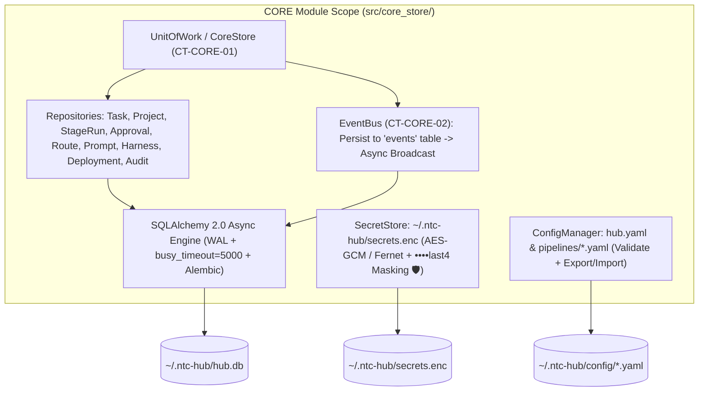
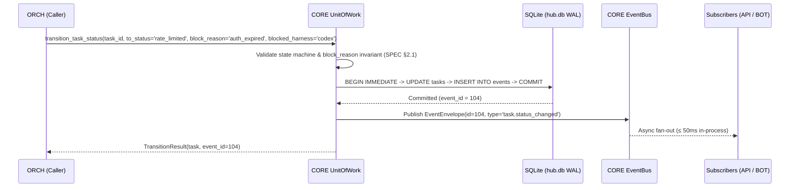
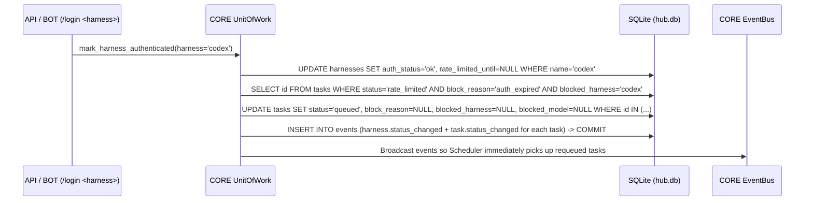

# Module Blueprint: CORE - Persistence, Config, Secrets & Event Bus

> **Module Code:** `CORE`  
> **Slug:** `core-store` (this file: `docs/plans/modules/core-store.md`)  
> **Code Root:** `src/core_store/`  
> **Project Roadmap:** `docs/plans/system-roadmap.md#2-module-registry`  
> **Contract Registry:** `docs/plans/contract-registry.md`  
> **Status:** `READY`  
> **Last Updated:** 2026-10-24 15:00  

<!--
STRUCTURE INVARIANTS (checked by scripts/validate-plans.ps1):
- Keep the heading "## 7. Module Phase Sequence" and its table header names.
- Phase IDs: <MOD>-P<NN> using this module's code. Dossier files: phase-<NN>-<slug>.md
- Phase status: PENDING | ACTIVE | BLOCKED | COMPLETED
  ACTIVE    -> dossier must exist in docs/plans/active/<module-slug>/
  COMPLETED -> dossier must exist in docs/plans/completed/<module-slug>/
- This blueprint must not contradict the Project Roadmap or the Contract Registry.
-->

---

## 1. Module Charter
- **Responsibility (one sentence):** Owns all durable state of `ntc-ai-center-hub` (`~/.ntc-hub/hub.db` in SQLite WAL mode, encrypted `~/.ntc-hub/secrets.enc`, and YAML configuration files) together with the transactional `EventBus` that guarantees persist-before-side-effect and multi-channel state synchronization.
- **Bounded Context / Ubiquitous Language:** Unit of Work (`CoreStore`), Persist-Before-Side-Effect State Machine (`TaskRepository.transition_status`), Block Reason Invariant (`block_reason` ∈ `{'rate_limit', 'auth_expired'}`), Encrypted Secret Vault (`SecretStore`), Append-Only Audit Log (`AuditRepository`), Monotonic Event Stream (`EventBus`).
- **In-Scope:**
  - [ ] Codify `CT-CORE-01` (`contracts/core/store-protocol.py`) and `CT-CORE-02` (`contracts/events/hub-events.schema.json`).
  - [ ] Configure SQLAlchemy 2.0 async engine (`aiosqlite`) with mandatory SQLite pragmas (`journal_mode=WAL`, `synchronous=NORMAL`, `busy_timeout=5000`, `foreign_keys=ON`) and Alembic migrations (`X-02`).
  - [ ] Implement repositories for all domain entities (`PROJECT`, `TASK`, `STAGE_RUN`, `AGENT_RUN`, `APPROVAL`, `ARTIFACT`, `INTERVIEW`, `MESSAGE`, `HARNESS`, `ROUTE`, `PROMPT`, `PROMPT_VERSION`, `DEPLOYMENT`, `audit_log`, `events`).
  - [ ] Enforce the `TASK.block_reason` invariant (`SPEC §2.1`, `D-05`): `block_reason` (`rate_limit | auth_expired`), `blocked_harness`, and `blocked_model` are non-null iff `status == 'rate_limited'`, and automatically cleared whenever transitioning out of `rate_limited`.
  - [ ] Implement `SecretStore` (`~/.ntc-hub/secrets.enc`) using authenticated encryption (AES-GCM / Fernet with key in OS keyring or `0600` keyfile owned by `ntchub`) and `••••last4` masking (`NFR-1`, `X-01 🛡`).
  - [ ] Implement YAML configuration loader/validator (`config/hub.yaml`, `config/pipelines/*.yaml`) and secret-free YAML export/import (`FR-46`, `AC-M4-11.1 🛡`).
  - [ ] Implement transactional `EventBus` that persists each event to the `events` table (`event_id`) before broadcasting to in-process subscribers (`ORCH`, `API`, `BOT`).
- **Out-of-Scope (owned elsewhere):**
  - Spawning Docker containers or parsing harness CLI outputs → `ADP`
  - Running `git` commands, managing worktrees, or calling GitHub APIs → `GIT`
  - Orchestrating pipeline loops, scheduling slots, running interviews, or splitting report messages → `ORCH`
  - FastAPI HTTP/WebSocket transport → `API`

## 2. Tech Stack & Runtime
- **Language / Runtime:** Python 3.12+ (`asyncio`).
- **Frameworks & Libraries:** `sqlalchemy[asyncio]>=2.0`, `aiosqlite`, `alembic`, `pydantic>=2.7`, `cryptography` (Fernet / AESGCM), `keyring` (optional OS keyring integration), `PyYAML`.
- **Storage:**
  - SQLite database at `~/.ntc-hub/hub.db` (WAL mode).
  - Encrypted secret store at `~/.ntc-hub/secrets.enc` (`0600`).
  - YAML configuration files at `~/.ntc-hub/config/`.
- **AI Skills Activated (`AI-skill-help.md`):**
  - [`sqlalchemy-2-async-sqlite`](file:///d:/vibe-code/ntc-ai-center-hub/.agents/skills/sqlalchemy-2-async-sqlite/SKILL.md) — WAL pragma listener, persist-before-side-effect transactions, `block_reason` invariant, crash recovery queries, append-only `audit_log`.
  - [`python-testing-patterns`](file:///d:/vibe-code/ntc-ai-center-hub/.agents/skills/python-testing-patterns/SKILL.md) — Concurrent async SQLite stress tests, secret leak scanner (`X-01 🛡`).
- **Build / Test Commands:** `pytest tests/core_store -q`

## 3. Internal Architecture

## 4. Data Ownership
| Entity / Table | Key Attributes | Storage | Notes |
| :--- | :--- | :--- | :--- |
| `projects` | `id`, `slug` (unique), `repo_full_name`, `default_branch`, `test_cmd`, `build_cmd`, `deploy_target`, `deploy_config_json`, `route_overrides_json`, `gate_overrides_json` | `hub.db` | Modifying `test_cmd` automatically appends an `audit_log` record (`AC-M4-09.2 🛡`). |
| `tasks` | `id`, `project_id`, `kind`, `status`, `block_reason`, `blocked_harness`, `blocked_model`, `current_stage`, `branch`, `worktree_path`, `tg_topic_id`, `tg_pinned_msg_id`, `gate_overrides_json`, `auto_mode`, `fix_rounds`, `created_at` | `hub.db` | Check constraint enforces `block_reason IS NULL` when `status != 'rate_limited'` (`SPEC §2.1`). |
| `stage_runs` | `id`, `task_id`, `stage`, `status`, `attempt`, `started_at`, `ended_at`, `summary`, `error_signature` | `hub.db` | Tracks each stage attempt and normalized test error signature (`AC-M1-10.3`). |
| `agent_runs` | `id`, `stage_run_id`, `harness`, `model`, `session_id`, `exit_code`, `tokens_in`, `tokens_out`, `duration_s`, `log_path`, `used_fallback` | `hub.db` | Feeds `US-M3-07` quota statistics and `FR-36` report usage line. |
| `approvals` | `id`, `task_id`, `gate`, `status`, `comment`, `channel`, `decided_at` | `hub.db` | Guarantees idempotent single-decision resolution across CLI, Telegram, Webapp (`AC-M1-12.3`). |
| `artifacts` | `id`, `task_id`, `name`, `path`, `version`, `round`, `created_at` | `hub.db` | Versioned index of `spec.md`, `plan.md`, `test-report.md`, `review.json`, `REPORT.md`. |
| `interviews` & `messages` | `id`, `task_id`, `status`, `spec_path`, `turn_count`; `sender`, `content`, `suggestions_json` | `hub.db` | Supports pause/resume across CLI, Telegram, and Webapp (`FR-6`, `AC-M1-03.6`). |
| `harnesses` | `name` (PK), `auth_status`, `last_check`, `rate_limited_until`, `max_concurrent`, `model_limits_json` | `hub.db` | Tracks live auth state and per-harness / per-model concurrency caps (`US-M3-06`). |
| `routes` | `id`, `role`, `scope` (`global \| project:<id> \| task:<id>`), `harness`, `model`, `prompt_id`, `timeout_s`, `fallbacks_json` | `hub.db` | Resolved in order `task → project → global` (`ARCH §4`, `US-M3-08`). Rejects API keys on OAuth harnesses (`AC-M3-03.2 🛡`). |
| `prompts` & `prompt_versions` | `id`, `role`, `kind`, `current_version`; `version`, `template_text`, `created_at` | `hub.db` | Immutable version history with rollback support (`FR-18`, `AC-M1-04.5`). |
| `deployments` | `id`, `project_id`, `env`, `target`, `status`, `url`, `ref`, `created_at` | `hub.db` | Tracks preview and staging/prod deployments for `/rollback` (`US-M5-04`, `US-M5-05`). |
| `audit_log` | `id`, `timestamp`, `task_id`, `project_id`, `action`, `ref`, `result`, `detail` | `hub.db` | Append-only (`FR-31`, `AC-M1-11.5`); no `UPDATE` or `DELETE` methods exposed. |
| `events` | `id` (monotonic PK), `task_id`, `event_type`, `payload_json`, `created_at` | `hub.db` | Enables `?since_event_id=` replay on WebSocket reconnect (`AC-M4-02.4`). |
| `secrets.enc` | Encrypted JSON map (`github_token`, `telegram_bot_token`, `api_keys.<provider>`, `vercel_token`, `cloudflare_token`) | `~/.ntc-hub/secrets.enc` | Never exported by `config export`, never logged, masked as `••••last4` in DTOs (`X-01 🛡`). |

## 5. Interfaces
### 5.1 Provided Contracts
| Contract ID | Type | Purpose | Consumers |
| :--- | :--- | :--- | :--- |
| `CT-CORE-01` | Library | Async repositories, transactional state transitions (`transition_task_status`), route resolver (`task → project → global`), `SecretStore`, `AuditRepository`, and `ConfigManager`. | `ADP`, `GIT`, `ORCH`, `DEP`, `API` |
| `CT-CORE-02` | Event | Typed event envelopes (`TaskStatusChanged`, `StageTransitioned`, `ApprovalRequested`, `ApprovalResolved`, `HarnessStatusChanged`) persisted to `events` and broadcast via `EventBus`. | `ORCH`, `API`, `BOT` |

### 5.2 Consumed Contracts
| Contract ID | Provider | Purpose | Required By Phase |
| :--- | :--- | :--- | :--- |
| `CT-SYS-01` | `SYS` | Canonical enums (`TaskKind`, `TaskStatus`, `BlockReason`, `RoleName`, `GateName`, `DeployTargetType`, `StageStatus`, `ApprovalStatus`) | `CORE-P01` |

### 5.3 Events
- **Published (`CT-CORE-02`):** `task.created`, `task.status_changed`, `stage.started`, `stage.completed`, `approval.requested`, `approval.resolved`, `harness.status_changed`, `deployment.updated`.
- **Subscribed:** None (`CORE` is the root event publisher).

## 6. Core Flows

### Flow 1: Persist-Before-Side-Effect State Transition & Event Emission (`CORE-P01`)

- **Business invariants:**
  - If `to_status == 'rate_limited'`, `block_reason` MUST be `'rate_limit'` or `'auth_expired'` and `blocked_harness` MUST be non-empty.
  - If `to_status != 'rate_limited'`, `block_reason`, `blocked_harness`, and `blocked_model` are automatically set to `NULL` in the same SQL `UPDATE`.
  - Subscribers are notified **only after** the SQLite transaction commits.

### Flow 2: Bulk Unblock Tasks on Harness Re-Authentication (`CORE-P02` / `AC-M2-08.3`)

## 7. Module Phase Sequence

| Phase | Title | Objective | Aligns to GP | Depends On | Dossier | Status |
| :--- | :--- | :--- | :--- | :--- | :--- | :--- |
| `CORE-P01` | Contracts (`CT-CORE-01/02`), SQLite WAL Schema, Repositories, Secrets & EventBus | Codify `CT-CORE-01` & `CT-CORE-02`, implement SQLite WAL engine + Alembic migrations, all M1 repositories, `block_reason` invariants, `SecretStore` (`secrets.enc`), YAML config validation, and `EventBus` | `GP-01` | `CT-SYS-01` | — | `PENDING` |
| `CORE-P02` | Telegram Topic Mapping & Auth-Expiry Bulk Unblock | Add topic/pinned-message lookup queries, atomic bulk unblock on `/login <harness>` (`AC-M2-08.3`), and private-chat secret rotation helpers | `GP-02` | `CORE-P01` | — | `PENDING` |
| `CORE-P03` | Webapp Auth Sessions, Event Replay & Config Export/Import | Add Webapp session/TOTP/magic-link persistence, `events` cursor replay (`?since_event_id=`), secret-free YAML export/import (`AC-M4-11.1 🛡`), and filtered audit queries | `GP-04` | `CORE-P02` | — | `PENDING` |

## 8. Module Invariants & Non-Functional Requirements
- **Performance:** Point lookups and state transitions complete in `< 10ms` under 4 concurrent tasks (`busy_timeout=5000` + WAL mode prevents `SQLITE_BUSY`).
- **Security (`🛡`):**
  - `SecretStore` encrypts at rest; `get_masked_secrets()` returns only `••••<last4>`.
  - `ConfigManager.export_yaml()` structurally excludes `SecretStore` and strips any field matching `*_token`, `*_key`, `*_secret` (`AC-M4-11.1 🛡`).
  - `RouteRepository` rejects any route that binds an API key to `claude-code`, `codex`, or `antigravity` (`AC-M3-03.2 🛡`).
- **Resilience:** `AuditRepository` is strictly append-only; updating `PROJECT.test_cmd` writes an audit entry inside the same transaction (`AC-M4-09.2 🛡`).
- **Observability:** Every state change produces a persisted row in `events` with a monotonic `id`.

## 9. Risks & Open Questions
- **OS Keyring on Headless Linux VPS:** Headless VPS instances often lack a D-Bus Secret Service daemon. `SecretStore` will try OS keyring first and automatically fall back to a dedicated master key file at `~/.ntc-hub/master.key` with strict `0600` file permissions verified on startup (failing fast if permissions are broader than `0600`).
