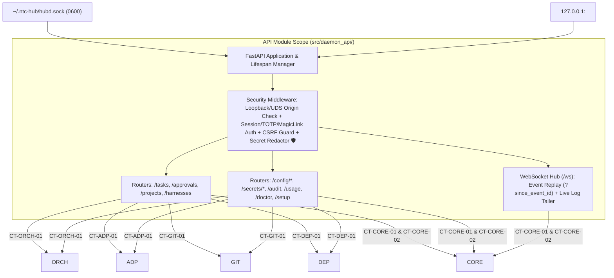
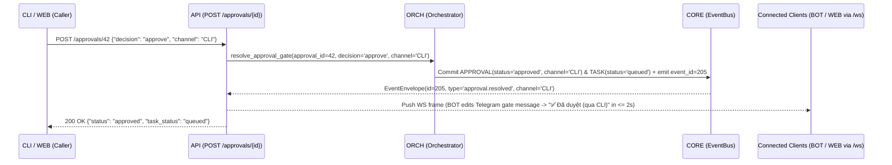
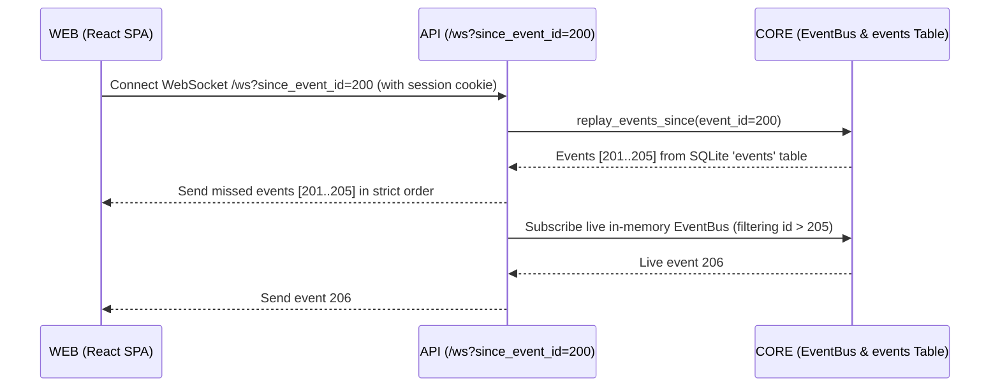

# Module Blueprint: API - hubd FastAPI REST + WebSocket Server

> **Module Code:** `API`  
> **Slug:** `daemon-api` (this file: `docs/plans/modules/daemon-api.md`)  
> **Code Root:** `src/daemon_api/`  
> **Project Roadmap:** `docs/plans/system-roadmap.md#2-module-registry`  
> **Contract Registry:** `docs/plans/contract-registry.md`  
> **Status:** `READY`  
> **Last Updated:** 2026-10-24 15:16  

<!--
STRUCTURE INVARIANTS (checked by scripts/validate-plans.ps1):
- Keep the heading "## 7. Module Phase Sequence" and its table header names.
- Phase IDs: <MOD>-P<NN> using this module's code. Dossier files: phase-<NN>-<slug>.md
- Phase status: PENDING | ACTIVE | BLOCKED | COMPLETED
  ACTIVE    -> dossier must exist in docs/plans/active/<module-slug>/
  COMPLETED -> dossier must exist in docs/plans/completed/<module-slug>/
- This blueprint must not contradict the Project Roadmap or the Contract Registry.
-->

---

## 1. Module Charter
- **Responsibility (one sentence):** Exposes the single unified REST (`CT-API-01`) and WebSocket (`CT-API-02`) API of `hubd` over both a local Unix domain socket (`~/.ntc-hub/hubd.sock` `0600` for `CLI`) and loopback HTTP (`127.0.0.1:<port>` for `BOT`, `WEB`, and Cloudflare Tunnel), enforcing transport authentication, CSRF protection, and `••••last4` secret masking.
- **Bounded Context / Ubiquitous Language:** Dual-Listener Transport (`UnixSocket + LoopbackHTTP`), Event Replay Stream (`/ws?since_event_id=`), Second-Layer Webapp Auth (`Session + TOTP / Telegram Magic Link + CSRF`), Masked Secret DTO (`••••last4` `X-01 🛡`), System Health Aggregator (`/doctor`).
- **In-Scope:**
  - [ ] Codify `CT-API-01` (`contracts/openapi/hubd-rest.yaml`) and `CT-API-02` (`contracts/events/ws-stream.schema.json`).
  - [ ] Configure Uvicorn + FastAPI to listen on `~/.ntc-hub/hubd.sock` (permissions `0600` owned by `ntchub`, passwordless for local `CLI` — `AC-M1-01.3`) and `127.0.0.1:<port>` (never `0.0.0.0` — `AC-M4-01.1 🛡`).
  - [ ] Implement REST routers for Tasks, Interviews, Approvals, Projects, Harnesses, Routes, Prompts (with version diff/rollback), Pipelines, Gates & Limits, Secrets, Deployments, Audit Log, Usage, Setup Wizard, and Doctor checks (`ARCH §11`).
  - [ ] Implement WebSocket `/ws` endpoint supporting `?since_event_id=<id>` event replay from `CORE.events` (`AC-M4-02.4`) and live agent output/log streaming for `hub logs -f`, `hub attach`, and Webapp (`X-08`).
  - [ ] Implement Webapp authentication (`Password + TOTP` or Telegram bot magic link — `AC-M4-01.3`) and CSRF token verification on all state-mutating HTTP requests (`POST`, `PUT`, `DELETE` — `AC-M4-01.4`).
  - [ ] Guarantee that no endpoint ever logs raw secrets or returns unmasked secrets in any response payload (`AC-M4-08.3`, `X-01 🛡`).
- **Out-of-Scope (owned elsewhere):**
  - Pipeline orchestration, scheduling, or message splitting logic → `ORCH`
  - Direct SQLite queries or secret encryption primitives → `CORE`
  - Terminal rendering (`CLI`), Telegram `aiogram` polling (`BOT`), or React components (`WEB`)

## 2. Tech Stack & Runtime
- **Language / Runtime:** Python 3.12+ (`asyncio`).
- **Frameworks & Libraries:** `fastapi`, `uvicorn[standard]`, `pydantic>=2.7`, `pyotp` (TOTP verification), `itsdangerous` / `cryptography` (signed session cookies & CSRF tokens).
- **Storage:** Stateless transport layer; delegates all persistence to `CORE` (`CT-CORE-01`).
- **AI Skills Activated (`AI-skill-help.md`):**
  - [`python-fastapi-development`](file:///d:/vibe-code/ntc-ai-center-hub/.agents/skills/python-fastapi-development/SKILL.md) — Dual-listener Uvicorn setup, `asynccontextmanager` lifespan, `/ws?since_event_id=` event replay, CSRF & secret masking checklist (`🛡`).
  - [`python-testing-patterns`](file:///d:/vibe-code/ntc-ai-center-hub/.agents/skills/python-testing-patterns/SKILL.md) — Async `httpx.ASGITransport` endpoint tests, secret redaction verification (`X-01 🛡`).
- **Build / Test Commands:** `pytest tests/daemon_api -q`

## 3. Internal Architecture

## 4. Data Ownership
| Entity / Artifact | Key Attributes | Storage | Notes |
| :--- | :--- | :--- | :--- |
| `hubd-rest.yaml` | OpenAPI 3.1 schema for all REST endpoints and Pydantic v2 DTOs | `contracts/openapi/hubd-rest.yaml` | Codified contract `CT-API-01`. |
| `ws-stream.schema.json` | JSON Schema for WebSocket client subscriptions and server event/log frames | `contracts/events/ws-stream.schema.json` | Codified contract `CT-API-02`. |

## 5. Interfaces
### 5.1 Provided Contracts
| Contract ID | Type | Purpose | Consumers |
| :--- | :--- | :--- | :--- |
| `CT-API-01` | REST | Full REST API for task creation, interview messaging, gate approvals, project management, harness login, routing/prompt/pipeline/gate configuration, preview/deploy/rollback, doctor, and setup wizard. | `CLI`, `BOT`, `WEB` |
| `CT-API-02` | Event | WebSocket `/ws` streaming interface for real-time task/approval/harness events (`?since_event_id=`) and per-task live agent stdout/log streams. | `CLI`, `BOT`, `WEB` |

### 5.2 Consumed Contracts
| Contract ID | Provider | Purpose | Required By Phase |
| :--- | :--- | :--- | :--- |
| `CT-SYS-01` | `SYS` | Shared domain enums | `API-P01` |
| `CT-CORE-01` | `CORE` | Query/update projects, tasks, routes, prompts, gates, secrets (`••••last4`), audit logs, and Webapp sessions | `API-P01` → `API-P05` |
| `CT-CORE-02` | `CORE` | Subscribe to `EventBus` and replay missed events from `events` table on `/ws` reconnect | `API-P01` → `API-P04` |
| `CT-ADP-01` | `ADP` | Query harness auth/models and trigger device-code `login()` | `API-P01`, `API-P03` |
| `CT-GIT-01` | `GIT` | Verify GitHub connection, add projects, and fetch task branch diffs | `API-P01`, `API-P04` |
| `CT-ORCH-01` | `ORCH` | Execute task, interview, gate, merge, and report operations | `API-P01` → `API-P04` |
| `CT-DEP-01` | `DEP` | Execute preview, teardown, deploy, rollback, and Cloudflare Tunnel setup | `API-P04`, `API-P05` |

### 5.3 Events
- **Published (`CT-API-02`):** Streams `EventEnvelope` and `LogLineFrame` over `/ws` to connected `CLI`, `BOT`, and `WEB` clients within `≤ 2 seconds` (`AC-M4-02.4`, `X-08`).
- **Subscribed (`CT-CORE-02`):** Subscribes to all `CORE` `EventBus` topics and bridges them to active WebSocket connections.

## 6. Core Flows

### Flow 1: Cross-Channel Gate Approval & Real-Time Broadcast (`API-P01` & `API-P02` / `AC-M2-04.4`, `X-08`)

### Flow 2: WebSocket Reconnect with `?since_event_id=` Replay (`API-P04` / `AC-M4-02.4`)

## 7. Module Phase Sequence

| Phase | Title | Objective | Aligns to GP | Depends On | Dossier | Status |
| :--- | :--- | :--- | :--- | :--- | :--- | :--- |
| `API-P01` | Contracts (`CT-API-01/02`), Unix Socket Server, M1 REST Endpoints & `/ws` Stream | Codify `CT-API-01` & `CT-API-02`, bind `~/.ntc-hub/hubd.sock` (`0600`), implement M1 task/interview/approval/project/route/prompt/audit/doctor endpoints and live `/ws` stream | `GP-01` | `CT-SYS-01`, `CT-CORE-01`, `CT-CORE-02`, `CT-ADP-01`, `CT-GIT-01`, `CT-ORCH-01` | — | `PENDING` |
| `API-P02` | Cross-Channel Gate Sync, `/spec` & `/plan` Viewers & Private Secret Endpoints | Add channel-tagged approval resolution, on-demand `/spec` & `/plan` artifact endpoints (`AC-M2-04.7`), and zero-log `/secrets/*` endpoints (`AC-M2-09.3 🛡`) | `GP-02` | `API-P01`, `CORE-P02`, `ORCH-P02` | — | `PENDING` |
| `API-P03` | `/new` Task Endpoint, `/secrets/apikey`, Scoped Routes & `/usage` Stats | Expose `/new` intake, provider API-key registration (`AC-M3-03.1`), scoped route CRUD + `--explain` (`US-M3-08`), and quota usage stats (`US-M3-07`) | `GP-03` | `API-P02`, `ADP-P02`, `GIT-P02`, `ORCH-P03` | — | `PENDING` |
| `API-P04` | Loopback HTTP (`127.0.0.1`), Webapp Session/TOTP/MagicLink Auth, CSRF, Diff & Config Export/Import | Bind `127.0.0.1:<port>` (`AC-M4-01.1 🛡`), implement Webapp login + CSRF guard (`AC-M4-01.3/01.4`), `/ws?since_event_id=` replay (`AC-M4-02.4`), `/tasks/{id}/diff`, pipeline validation (`US-M4-06`), and YAML export/import (`US-M4-11 🛡`) | `GP-04` | `API-P03`, `CORE-P03`, `ORCH-P04`, `DEP-P01` | — | `PENDING` |
| `API-P05` | Preview/Deploy/Rollback Endpoints & Multi-Channel `/setup` Wizard API | Expose `/tasks/{id}/preview` & `/down`, `/projects/{id}/deploy` & `/rollback`, and stateful `/setup` step-machine endpoints (`US-M5-07`) | `GP-05` | `API-P04`, `DEP-P02` | — | `PENDING` |

## 8. Module Invariants & Non-Functional Requirements
- **Performance:** Read endpoints (`GET /tasks`, `GET /tasks/{id}`) respond in `< 50ms` (`X-05`); WebSocket event delivery latency `< 200ms` in-process (`≤ 2s` end-to-end `AC-M4-02.4`).
- **Security (`🛡`):**
  - Network binding validator refuses to start if HTTP bind host is not `127.0.0.1` or `::1` (`AC-M4-01.1 🛡`).
  - Unix socket `~/.ntc-hub/hubd.sock` is created with `chmod 0600` before accepting connections (`AC-M1-01.3`).
  - Requests arriving on the TCP loopback listener (`127.0.0.1:<port>`) require a valid Webapp session (or local `BOT` internal token) and CSRF token on `POST`/`PUT`/`DELETE` (`AC-M4-01.4`).
  - Access log filter scrubs request bodies on `/secrets/*` and `/setup` so secret values never appear in logs (`AC-M2-09.3 🛡`, `X-01 🛡`).
- **Resilience:** Lifespan handler cleanly cancels background tasks and closes WebSocket streams on `SIGTERM`/`SIGINT`.
- **Observability:** OpenAPI schema at `contracts/openapi/hubd-rest.yaml` stays 100% synchronized with FastAPI `app.openapi()` via contract unit test.

## 9. Risks & Open Questions
- **Windows / WSL2 Unix Socket Compatibility:** Both Linux VPS and Windows WSL2 support `AF_UNIX` domain sockets natively in Python 3.12 + Uvicorn (`uds="~/.ntc-hub/hubd.sock"`). For pure-Windows unit test runners outside WSL2, `API` tests use `httpx.ASGITransport(app=app)` in-memory and loopback `127.0.0.1:0` to remain OS-agnostic.
