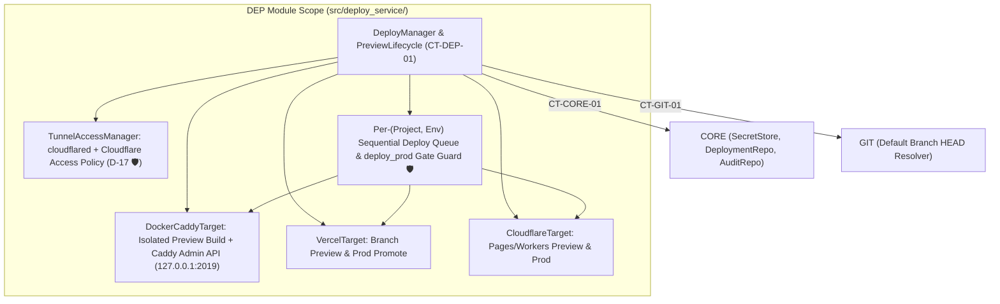

# Module Blueprint: DEP - Preview, Deploy & Cloudflare Tunnel Service

> **Module Code:** `DEP`  
> **Slug:** `deploy-service` (this file: `docs/plans/modules/deploy-service.md`)  
> **Code Root:** `src/deploy_service/`  
> **Project Roadmap:** `docs/plans/system-roadmap.md#2-module-registry`  
> **Contract Registry:** `docs/plans/contract-registry.md`  
> **Status:** `READY`  
> **Last Updated:** 2026-10-24 15:09  

<!--
STRUCTURE INVARIANTS (checked by scripts/validate-plans.ps1):
- Keep the heading "## 7. Module Phase Sequence" and its table header names.
- Phase IDs: <MOD>-P<NN> using this module's code. Dossier files: phase-<NN>-<slug>.md
- Phase status: PENDING | ACTIVE | BLOCKED | COMPLETED
  ACTIVE    -> dossier must exist in docs/plans/active/<module-slug>/
  COMPLETED -> dossier must exist in docs/plans/completed/<module-slug>/
- This blueprint must not contradict the Project Roadmap or the Contract Registry.
-->

---

## 1. Module Charter
- **Responsibility (one sentence):** Manages zero-trust remote access via Cloudflare Tunnel + Cloudflare Access (`D-17 🛡`), ephemeral task previews (`docker` + Caddy dynamic routing, `vercel`, `cloudflare` with 24h auto-teardown), and gated staging/production deployments & rollbacks (`deploy_prod` 🔒).
- **Bounded Context / Ubiquitous Language:** Zero-Trust Tunnel (`TunnelAccessManager`), Dynamic Preview Router (`CaddyAdminClient`), Pluggable Deploy Target (`DeployTarget`: `DockerCaddyTarget`, `VercelTarget`, `CloudflareTarget`), Preview TTL Reaper (`PreviewLifecycle`), Mandatory Prod Gate (`deploy_prod` 🔒 `AC-M5-04.3 🛡`).
- **In-Scope:**
  - [ ] Codify `CT-DEP-01` (`contracts/deploy/deploy-protocol.py`).
  - [ ] Implement `TunnelAccessManager` (`D-17`, `US-M4-01 🛡`, `US-M5-01 🛡`): provision `cloudflared` tunnel + ingress (`hub.<domain>` → `127.0.0.1:<hub_port>` and `*.preview.<domain>` → `127.0.0.1:<caddy_port>`), configure Cloudflare Access policy restricting access strictly to `owner_email`, and provide `hub doctor` verification checks.
  - [ ] Implement `DockerCaddyTarget` (`US-M5-01 🛡`): build preview image from task branch `Dockerfile` / `compose.yaml` with CPU/RAM limits and zero hub secrets / Docker socket mounts (`AC-M5-01.3 🛡`), register dynamic route `<task>.preview.<domain>` via Caddy Admin API (`127.0.0.1:2019`), and deploy production via tagged `compose up -d`.
  - [ ] Implement `VercelTarget` and `CloudflareTarget` (`US-M5-02 🛡`) using tokens from `CORE.SecretStore` (never exposed to agent containers `AC-M5-02.2 🛡`).
  - [ ] Implement 24h preview TTL auto-teardown, `/down [id]` teardown, and automatic teardown on task `done`/`cancelled` (`US-M5-03`).
  - [ ] Implement `DeployManager` (`US-M5-04 🛡`, `US-M5-05`, `US-M5-06`): enforce that deploy never triggers automatically after merge (`AC-M5-04.1 🛡`), require task merged (`D-06`, `AC-M5-04.2`), enforce `deploy_prod` approval gate even under `/auto on` (`AC-M5-04.3 🛡`), queue concurrent deploys per `(project, env)` sequentially (`AC-M5-04.5`), and support `/rollback <project> [env]`.
- **Out-of-Scope (owned elsewhere):**
  - Merging Pull Requests or managing git worktrees → `GIT`
  - Running coding/testing pipeline stages → `ORCH`
  - Storing `deployments` and `audit_log` rows → `CORE`

## 2. Tech Stack & Runtime
- **Language / Runtime:** Python 3.12+ (`asyncio`).
- **Frameworks & Libraries:** `httpx` (Cloudflare API, Caddy Admin API `http://127.0.0.1:2019`, Vercel REST API), `PyYAML` (`.hub/deploy.yml` & `cloudflared` config), `pydantic>=2.7`.
- **Storage:** Persists deployment & preview records via `CORE` (`deployments` table + `audit_log`); manages `~/.ntc-hub/cloudflared/` tunnel config.
- **AI Skills Activated (`AI-skill-help.md`):**
  - [`cloudflare-tunnel-caddy`](file:///d:/vibe-code/ntc-ai-center-hub/.agents/skills/cloudflare-tunnel-caddy/SKILL.md) — Loopback-only bindings, `cloudflared` ingress rules, Cloudflare Access `owner_email` policy, Caddy Admin API dynamic route registration (`🛡`).
  - [`docker-container-security`](file:///d:/vibe-code/ntc-ai-center-hub/.agents/skills/docker-container-security/SKILL.md) — Preview container resource limits and strict prohibition of mounting `~/.ntc-hub` or `/var/run/docker.sock` (`AC-M5-01.3 🛡`).
  - [`deploy-to-vercel`](file:///d:/vibe-code/ntc-ai-center-hub/.agents/skills/deploy-to-vercel/SKILL.md) — Vercel preview & production promotion patterns.
  - [`agent-browser`](file:///d:/vibe-code/ntc-ai-center-hub/.agents/skills/agent-browser/SKILL.md) & [`python-testing-patterns`](file:///d:/vibe-code/ntc-ai-center-hub/.agents/skills/python-testing-patterns/SKILL.md) — Verifying preview endpoints and Access edge blocking.
- **Build / Test Commands:** `pytest tests/deploy_service -q`

## 3. Internal Architecture


## 4. Data Ownership
| Entity / Artifact | Key Attributes | Storage | Notes |
| :--- | :--- | :--- | :--- |
| Tunnel Config | `tunnel_id`, `domain`, ingress rules (`hub.<domain>`, `*.preview.<domain>`) | `~/.ntc-hub/cloudflared/config.yml` | Managed by `TunnelAccessManager`; verified by `hub doctor` (`AC-M4-01.2`). |
| `.hub/deploy.yml` | Optional in-repo deploy config (`target`, `port`, `healthcheck_path`, `env_vars`) | `<repo>/.hub/deploy.yml` | Agent changes to `.hub/deploy.yml` take effect **only** for production deploys after PR merge (`AC-M5-06.1`). |

## 5. Interfaces
### 5.1 Provided Contracts
| Contract ID | Type | Purpose | Consumers |
| :--- | :--- | :--- | :--- |
| `CT-DEP-01` | Library | `DeployManager` (`create_preview`, `teardown_preview`, `request_deploy`, `execute_approved_deploy`, `request_rollback`, `reap_expired_previews`) and `TunnelAccessManager` (`setup_webapp_tunnel`, `check_tunnel_health`). | `API` |

### 5.2 Consumed Contracts
| Contract ID | Provider | Purpose | Required By Phase |
| :--- | :--- | :--- | :--- |
| `CT-SYS-01` | `SYS` | Shared enums (`DeployTargetType`, `GateName`, `ApprovalStatus`) | `DEP-P01` |
| `CT-CORE-01` | `CORE` | Read `SecretStore` tokens (`cloudflare`, `vercel`), persist `DEPLOYMENT` rows, create `deploy_*` `APPROVAL` records, and log to `audit_log` | `DEP-P01`, `DEP-P02` |
| `CT-GIT-01` | `GIT` | Resolve task worktree ref for preview and verify `default_branch` HEAD SHA for staging/prod deploy | `DEP-P02` |

### 5.3 Events
- **Published (via `CORE`):** Emits `deployment.updated` and `approval.requested` (for `deploy_staging` / `deploy_prod` gates).
- **Subscribed:** Subscribes to `task.status_changed` to automatically tear down active previews when a task transitions to `done` or `cancelled` (`AC-M5-03.1`).

## 6. Core Flows

### Flow 1: Docker Preview Creation & Caddy Route Registration (`DEP-P02` / `US-M5-01 🛡` & `US-M5-03`)
```mermaid
sequenceDiagram
    participant Api as API (/preview 12)
    participant Mgr as DEP DeployManager
    participant Dkt as DEP DockerCaddyTarget
    participant Cad as Caddy Admin API (127.0.0.1:2019)
    participant Core as CORE (DeploymentRepo)

    Api->>Mgr: create_preview(task_id=12)
    Mgr->>Dkt: build_and_run_preview(worktree_path, task_id=12, cpu_limit='1.0', mem_limit='512m')
    Note over Dkt: Never mounts ~/.ntc-hub or /var/run/docker.sock (AC-M5-01.3 🛡); binds 127.0.0.1:<ephemeral_port>
    Dkt-->>Mgr: ContainerStarted(container_id, internal_port=38120)
    Mgr->>Cad: POST /config/apps/http/servers/srv0/routes (host: "12.preview.<domain>" -> "127.0.0.1:38120")
    Cad-->>Mgr: 200 OK
    Mgr->>Core: upsert_deployment(env='preview', url='https://12.preview.<domain>', expires_at=now+24h)
    Mgr-->>Api: PreviewInfo(url='https://12.preview.<domain>', expires_in='24h')
```

### Flow 2: Gated Production Deploy & Sequential Queue (`DEP-P02` / `US-M5-04 🛡`)
```mermaid
sequenceDiagram
    participant Caller as API / BOT (/deploy shop-api prod)
    participant Mgr as DEP DeployManager 🛡
    participant Git as GIT (GitService)
    participant Core as CORE (Approval & Audit)
    participant Target as DEP Target (Docker / Vercel / CF)

    Caller->>Mgr: request_deploy(project='shop-api', env='prod', task_id=9)
    Mgr->>Mgr: Verify task #9 status == 'done' (merged); else reject "⛔ Cần merge trước khi deploy" (AC-M5-04.2)
    Mgr->>Git: get_default_branch_head_sha('shop-api')
    Git-->>Mgr: head_sha = 'a1b2c3d'
    Mgr->>Core: create_approval(gate='deploy_prod', status='pending') (Forced ON even if /auto on unless explicitly disabled on project - AC-M5-04.3 🛡)
    Core-->>Caller: Emit approval.requested ("🚀 Deploy prod cho shop-api · commit a1b2c3d")
    Note over Caller,Mgr: Owner clicks "✅ Duyệt"
    Caller->>Mgr: execute_approved_deploy(approval_id)
    Mgr->>Mgr: Enqueue in per-(project, env) sequential lock (AC-M5-04.5)
    Mgr->>Target: deploy(project='shop-api', ref='a1b2c3d', env='prod')
    Target-->>Mgr: DeploymentResult(url='https://shop-api.example.com', status='succeeded')
    Mgr->>Core: save_deployment(...) + append_audit_log(action='deploy.prod', ref='a1b2c3d', result='ok')
```

## 7. Module Phase Sequence

| Phase | Title | Objective | Aligns to GP | Depends On | Dossier | Status |
| :--- | :--- | :--- | :--- | :--- | :--- | :--- |
| `DEP-P01` | Contract (`CT-DEP-01`) & Cloudflare Tunnel + Access Manager (`D-17`) | Codify `CT-DEP-01` and implement `TunnelAccessManager` (`hub setup webapp`, `cloudflared` ingress for `hub.<domain>` & `*.preview.<domain>`, Cloudflare Access `owner_email` policy `🛡`, and `hub doctor` checks) | `GP-04` | `CT-SYS-01`, `CT-CORE-01` | — | `PENDING` |
| `DEP-P02` | Preview (`docker`/Caddy, `vercel`, `cloudflare`), 24h Reaper, Gated Deploy & Rollback | Implement `DockerCaddyTarget` (`🛡`), `VercelTarget`, `CloudflareTarget`, 24h TTL preview reaper (`US-M5-03`), gated staging/prod deploy (`deploy_prod` 🔒, sequential queue `US-M5-04 🛡`), `/rollback` (`US-M5-05`), and `.hub/deploy.yml` reader (`US-M5-06`) | `GP-05` | `DEP-P01`, `CT-GIT-01` | — | `PENDING` |

## 8. Module Invariants & Non-Functional Requirements
- **Performance:** Preview build + route registration completes in `≤ 10 minutes` (`AC-M5-01.1`); Caddy route registration/removal takes `< 100ms`.
- **Security (`🛡`):**
  - **Zero Public Ports (`D-17`, `AC-M5-01.5 🛡`):** Caddy and all preview containers bind strictly to `127.0.0.1` / internal Docker bridge; external traffic enters only via `cloudflared` after passing Cloudflare Access authentication.
  - **Mandatory Prod Gate (`AC-M5-04.3 🛡`):** `deploy_prod` ignores task `/auto on`; it can only be bypassed if `project.gate_overrides["deploy_prod"] == False` was explicitly set via two-step confirmation (`AC-M4-07.3`).
  - **No Automatic Post-Merge Deploy (`AC-M5-04.1 🛡`):** `DEP` exposes no event listener that triggers `deploy()` on PR merge; `deploy()` is reachable only from explicit user command handlers.
- **Resilience:** `PreviewLifecycle` background task runs every 5 minutes (and on `hubd` startup) to tear down expired previews (`> 24h`) and remove their Caddy routes and Docker containers.
- **Observability:** Every preview creation/teardown, deploy, and rollback writes an entry to `audit_log`.

## 9. Risks & Open Questions
- **Port Collisions Among Concurrent Local Docker Previews:** `DockerCaddyTarget` binds container host ports using `127.0.0.1:0:container_port` (letting the Linux kernel assign a guaranteed free ephemeral port) and inspects the assigned port via `docker port` before registering the upstream in Caddy Admin API.
