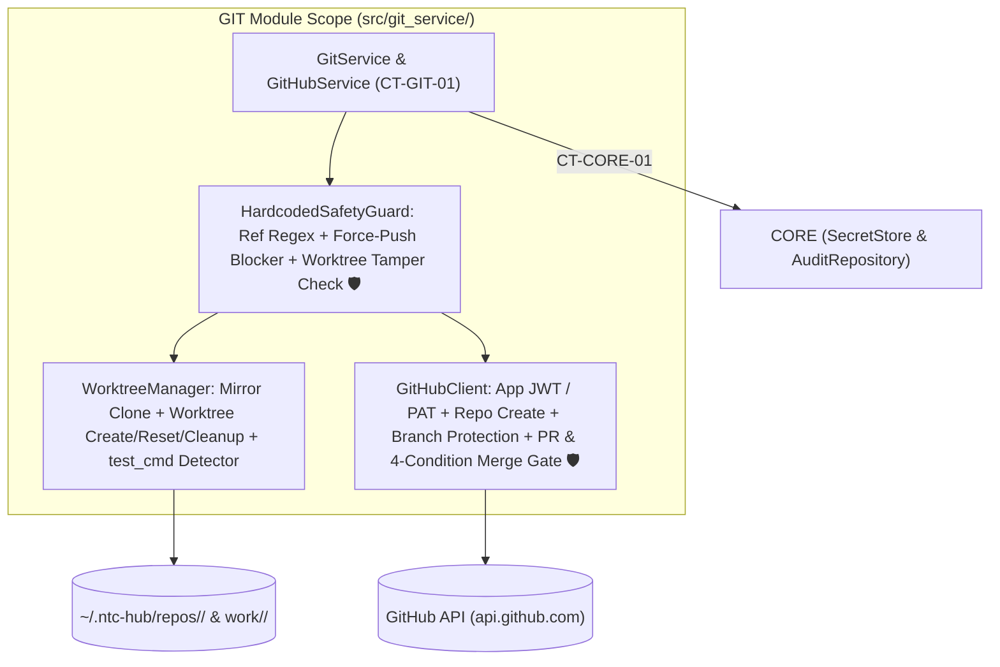
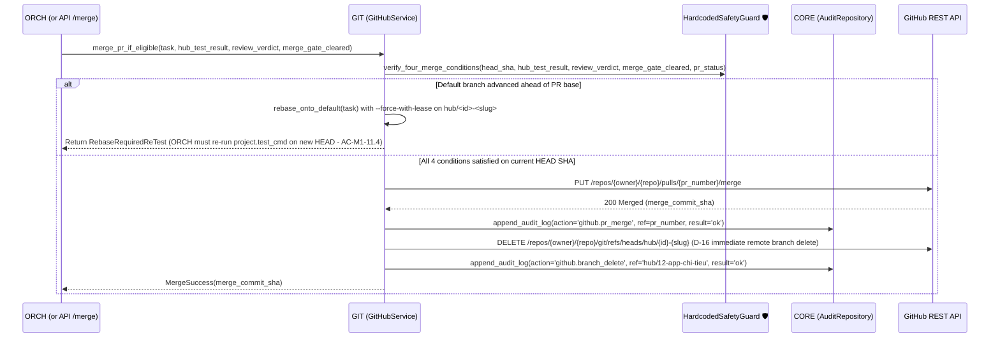

# Module Blueprint: GIT - Safe Git Worktree & GitHub Service

> **Module Code:** `GIT`  
> **Slug:** `git-service` (this file: `docs/plans/modules/git-service.md`)  
> **Code Root:** `src/git_service/`  
> **Project Roadmap:** `docs/plans/system-roadmap.md#2-module-registry`  
> **Contract Registry:** `docs/plans/contract-registry.md`  
> **Status:** `READY`  
> **Last Updated:** 2026-10-24 15:05  

<!--
STRUCTURE INVARIANTS (checked by scripts/validate-plans.ps1):
- Keep the heading "## 7. Module Phase Sequence" and its table header names.
- Phase IDs: <MOD>-P<NN> using this module's code. Dossier files: phase-<NN>-<slug>.md
- Phase status: PENDING | ACTIVE | BLOCKED | COMPLETED
  ACTIVE    -> dossier must exist in docs/plans/active/<module-slug>/
  COMPLETED -> dossier must exist in docs/plans/completed/<module-slug>/
- This blueprint must not contradict the Project Roadmap or the Contract Registry.
-->

---

## 1. Module Charter
- **Responsibility (one sentence):** Enforces **Anti-Goal #1 (`🛡` Never corrupt a repository)** by owning all local git mirror clones, isolated per-task git worktrees, hardcoded push/ref/tamper guards, GitHub API operations (PRs, 4-condition merge gate, new repo creation, branch protection), and `D-16` branch cleanup with mandatory `audit_log` recording.
- **Bounded Context / Ubiquitous Language:** Bare/Mirror Clone (`~/.ntc-hub/repos/<slug>/`), Task Worktree (`~/.ntc-hub/work/<id>/` on `hub/<id>-<slug>`), Hard Ref Guard (`^refs/heads/hub/[0-9]+-[a-z0-9-]+$`), Worktree Tamper Sanitizer (`.git/config` & `.git/hooks` hash verification), Four-Condition PR Merge Gate (`AC-M1-11.3 🛡`), Branch Lifecycle (`D-16`).
- **In-Scope:**
  - [ ] Codify `CT-GIT-01` (`contracts/git/git-service-protocol.py`).
  - [ ] Manage bare/mirror clones (`~/.ntc-hub/repos/<slug>/`) and auto-detect `test_cmd` / `build_cmd` from `package.json`, `pyproject.toml`, `Makefile`, `Cargo.toml`, `go.mod` (`US-M1-02`, `FR-10a`).
  - [ ] Create and manage isolated git worktrees (`~/.ntc-hub/work/<id>/`) on branch `hub/<id>-<slug>` with credential-free `origin` URLs so containerized agents cannot push (`AC-M1-11.1`, `AC-M1-05.3 🛡`).
  - [ ] Verify worktree integrity after every agent run: detect and reject any agent tampering with `.git/config`, `.git/hooks`, or `.hub/project.yml` (`AC-M1-08.3 🛡`, `AC-M1-11.6 🛡`).
  - [ ] Enforce hardcoded, non-configurable push guards (`AC-M1-11.2 🛡`): allow push **only** to `refs/heads/hub/<id>-<slug>`, forbid `--force` (except `--force-with-lease` on `hubd`'s own rebase of that task branch), forbid deleting non-`hub/*` branches.
  - [ ] Implement GitHub App / fine-grained PAT client for Pull Request creation/update, the **4-Condition PR Merge Gate** (`AC-M1-11.3 🛡`), automatic base-branch update + re-test (`AC-M1-11.4`), and `D-16` remote branch cleanup (`AC-M1-11.7 🛡`).
  - [ ] Implement new private GitHub repository creation, name-collision protection (`AC-M3-01.4 🛡`), initial commit on default branch, and default-branch protection setup (`US-M3-01`).
  - [ ] Record every external git/GitHub operation in `CORE.audit_log` (`FR-31`, `AC-M1-11.5`).
- **Out-of-Scope (owned elsewhere):**
  - Running `project.test_cmd` inside the agent container or validating `review.json` → `ORCH` (passes verified proof results into `GIT` merge check)
  - Storing `audit_log` or encrypted GitHub tokens → `CORE`

## 2. Tech Stack & Runtime
- **Language / Runtime:** Python 3.12+ (`asyncio.create_subprocess_exec` for `git` CLI; `httpx.AsyncClient` for GitHub REST/GraphQL API).
- **Frameworks & Libraries:** `httpx`, `PyJWT` + `cryptography` (for GitHub App installation token minting), `pydantic>=2.7`.
- **Storage:**
  - Bare/mirror git repositories at `~/.ntc-hub/repos/<project-slug>/`.
  - Per-task git worktrees at `~/.ntc-hub/work/<task-id>/`.
- **AI Skills Activated (`AI-skill-help.md`):**
  - [`ntchub-git-safety`](file:///d:/vibe-code/ntc-ai-center-hub/.agents/skills/ntchub-git-safety/SKILL.md) — Hard ref & force-push guards, `.git` tamper sanitizer, 4-condition PR merge gate, `D-16` branch cleanup (`🛡`).
  - [`python-testing-patterns`](file:///d:/vibe-code/ntc-ai-center-hub/.agents/skills/python-testing-patterns/SKILL.md) — Malicious-agent git regression suite (`AC-M1-11.6 🛡`) and unit tests for every rejected ref/force-push case (`AC-M1-11.2 🛡`).
- **Build / Test Commands:** `pytest tests/git_service -q`

## 3. Internal Architecture


## 4. Data Ownership
| Entity / Artifact | Key Attributes | Storage | Notes |
| :--- | :--- | :--- | :--- |
| Mirror Clones | Bare git clone of each registered project (`refs/heads/*`, objects) | `~/.ntc-hub/repos/<slug>/` | Synced before worktree creation and before merge checks. |
| Task Worktrees | Checked-out working tree on `hub/<id>-<slug>`, `.hub/` artifacts directory | `~/.ntc-hub/work/<id>/` | Cleaned up after `worktree_ttl_days` (default 7 days) or `/cleanup <id>` (`X-04`, `D-16`). |
| Repo Summary Cache | Cached markdown summary keyed by default-branch commit SHA | `~/.ntc-hub/cache/repo-summary/<slug>/<sha>.md` | Read/written via helper for `ORCH` (`FR-26`, `AC-M3-09.1`). |

## 5. Interfaces
### 5.1 Provided Contracts
| Contract ID | Type | Purpose | Consumers |
| :--- | :--- | :--- | :--- |
| `CT-GIT-01` | Library | `GitService` (`sync_mirror`, `detect_test_cmd`, `create_worktree`, `verify_worktree_untampered`, `commit_stage`, `reset_to_last_hub_commit`, `push_task_branch`, `rebase_onto_default`, `cleanup_task_branch_and_worktree`) & `GitHubService` (`verify_credentials`, `create_private_repo`, `open_or_update_pr`, `merge_pr_if_eligible`, `get_diff`). | `ORCH`, `DEP`, `API` |

### 5.2 Consumed Contracts
| Contract ID | Provider | Purpose | Required By Phase |
| :--- | :--- | :--- | :--- |
| `CT-SYS-01` | `SYS` | Shared domain enums (`TaskKind`, `TaskStatus`, `ApprovalStatus`) | `GIT-P01` |
| `CT-CORE-01` | `CORE` | Read GitHub credentials from `SecretStore` and append every git/GitHub action to `AuditRepository` (`audit_log`) | `GIT-P01`, `GIT-P02` |

### 5.3 Events
- **Published:** Writes audit records to `CORE` (`CT-CORE-01`); `ORCH` emits corresponding task/stage events.
- **Subscribed:** None.

## 6. Core Flows

### Flow 1: Post-Stage Tamper Check, Commit & Guarded Push (`GIT-P01` / `AC-M1-11.2 🛡` & `AC-M1-11.6 🛡`)
```mermaid
sequenceDiagram
    participant Orch as ORCH
    participant Git as GIT (GitService)
    participant Guard as HardcodedSafetyGuard 🛡
    participant Core as CORE (AuditRepository)
    participant Rem as GitHub Remote

    Orch->>Git: commit_and_push_stage(task_id=12, slug='app-chi-tieu', stage='code', round=0)
    Git->>Guard: verify_worktree_untampered(worktree_path)
    Guard->>Guard: Check .git/config & .git/hooks against baseline; revert any .hub/project.yml edits (AC-M1-08.3)
    Git->>Git: git add -A && git commit -m "hub(12): code round 0"
    Git->>Guard: assert_push_allowed(ref="refs/heads/hub/12-app-chi-tieu", force=False)
    Guard-->>Git: Allowed (matches ^refs/heads/hub/[0-9]+-[a-z0-9-]+$)
    Git->>Rem: git push origin refs/heads/hub/12-app-chi-tieu (with ephemeral auth header from hubd memory)
    Rem-->>Git: Push OK (HEAD sha)
    Git->>Core: append_audit_log(action='git.push', task_id=12, ref='refs/heads/hub/12-app-chi-tieu', result='ok')
    Git-->>Orch: CommitResult(head_sha)
```

### Flow 2: Four-Condition PR Merge Gate & `D-16` Branch Cleanup (`GIT-P01` / `AC-M1-11.3..11.7 🛡`)

- **Hardcoded 4-Condition Merge Invariants (`🛡`):**
  1. `hub_test_result.head_sha == current_pr_head_sha` and `hub_test_result.passed == True` (and for auto-merge: `project.test_cmd` is non-empty `AC-M1-08.5 🛡` and neither `test` nor `review` stage was disabled in pipeline `D-15`).
  2. `review_verdict == "approve"` (already validated by `D-07`).
  3. `merge_gate_cleared == True` (explicit approval record exists OR `merge` gate is off / `/auto on`).
  4. PR is mergeable (`mergeable_state == "clean"`, zero conflicts, up to date with `default_branch`).

## 7. Module Phase Sequence

| Phase | Title | Objective | Aligns to GP | Depends On | Dossier | Status |
| :--- | :--- | :--- | :--- | :--- | :--- | :--- |
| `GIT-P01` | Contract (`CT-GIT-01`), Mirror/Worktree Manager, Hardcoded Ref Guards, PR & 4-Condition Merge Gate | Codify `CT-GIT-01`, implement mirror clones, `test_cmd` detector, task worktrees, `.git` tamper check, hardcoded ref/force-push guards (`🛡`), PR creation, 4-condition merge gate (`🛡`), rebase flow, `D-16` branch cleanup, and `audit_log` | `GP-01` | `CT-SYS-01`, `CT-CORE-01` | — | `PENDING` |
| `GIT-P02` | New Private Repo Creation (`US-M3-01`), Collision Guard & Branch Protection | Implement `create_private_repo` (`AC-M3-01.3`), existing-repo name collision guard (`AC-M3-01.4 🛡`), initial commit on default branch (`AC-M3-01.6 🛡`), and branch protection with graceful fallback warning | `GP-03` | `GIT-P01` | — | `PENDING` |

## 8. Module Invariants & Non-Functional Requirements
- **Security (`🛡 Anti-Goal #1`):**
  - `HardcodedSafetyGuard` has **zero configuration flags** to bypass ref regex `^refs/heads/hub/[0-9]+-[a-z0-9-]+$`, force-push restriction, or the 4 merge conditions (`AC-M1-11.2`, `AC-M1-11.3`).
  - Git credentials are passed per-command via transient `GIT_ASKPASS` / HTTP header in `hubd` memory and are never written to `.git/config` or `~/.git-credentials`.
  - Malicious-agent test suite (`AC-M1-11.6 🛡`) mutates `.git/config`, adds a rogue remote, creates a local `main` branch, and installs a malicious `.git/hooks/pre-commit` inside the worktree — `GitService` detects and neutralizes all 4 before any host git command runs.
- **Resilience:** Failed pushes or GitHub 5xx errors retry with exponential backoff (up to 3 attempts) while recording every attempt in `audit_log`.
- **Observability:** 100% of external git/GitHub mutations emit an `audit_log` entry (`AC-M1-11.5`).

## 9. Risks & Open Questions
- **GitHub Free Tier Branch Protection on Private Repos:** GitHub Free accounts may return `403 Upgrade to GitHub Pro` when enabling branch protection on a private repository. As specified in `AC-M3-01.3`, `GitHubService` catches this specific `403`, logs a warning in `audit_log`, surfaces `"⚠ Gói GitHub không hỗ trợ branch protection cho repo private"` in the task report, and continues without failing the task (since `hubd`'s own hardcoded guards still protect the default branch).
