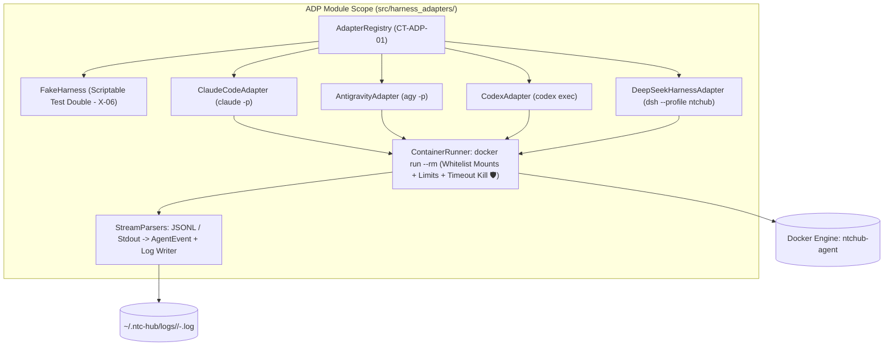
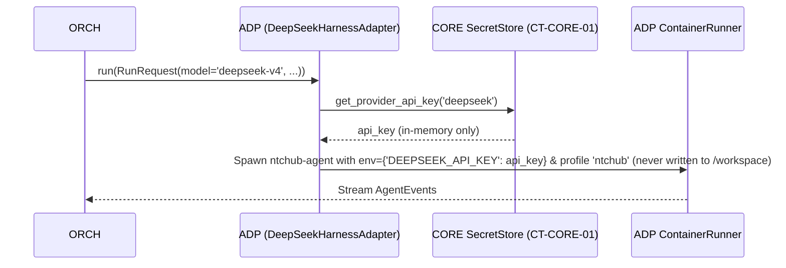

# Module Blueprint: ADP - Harness Adapters & Sandbox Container Runner

> **Module Code:** `ADP`  
> **Slug:** `harness-adapters` (this file: `docs/plans/modules/harness-adapters.md`)  
> **Code Root:** `src/harness_adapters/`  
> **Project Roadmap:** `docs/plans/system-roadmap.md#2-module-registry`  
> **Contract Registry:** `docs/plans/contract-registry.md`  
> **Status:** `READY`  
> **Last Updated:** 2026-10-24 15:03  

<!--
STRUCTURE INVARIANTS (checked by scripts/validate-plans.ps1):
- Keep the heading "## 7. Module Phase Sequence" and its table header names.
- Phase IDs: <MOD>-P<NN> using this module's code. Dossier files: phase-<NN>-<slug>.md
- Phase status: PENDING | ACTIVE | BLOCKED | COMPLETED
  ACTIVE    -> dossier must exist in docs/plans/active/<module-slug>/
  COMPLETED -> dossier must exist in docs/plans/completed/<module-slug>/
- This blueprint must not contradict the Project Roadmap or the Contract Registry.
-->

---

## 1. Module Charter
- **Responsibility (one sentence):** Encapsulates all interactions with external AI coding harnesses (`claude`, `agy`, `codex`, `dsh`) and `FakeHarness` behind the unified `HarnessAdapter` protocol (`CT-ADP-01`), executing every real agent inside an isolated ephemeral `ntchub-agent` Docker container via official headless CLIs only.
- **Bounded Context / Ubiquitous Language:** Unified Adapter Protocol (`HarnessAdapter`), Ephemeral Sandbox Runner (`ContainerRunner`), Stream Event Normalization (`AgentEvent`: `TextDelta`, `ToolCall`, `ToolResult`, `Usage`, `RateLimited`, `AuthExpired`, `Error`, `Done`), Headless CLI Invocation, Scriptable Test Double (`FakeHarness`).
- **In-Scope:**
  - [ ] Codify `CT-ADP-01` (`contracts/adapters/harness-protocol.py`).
  - [ ] Implement `ContainerRunner` spawning `ntchub-agent` with strict volume mount whitelist (`AC-M1-05.2 🛡`, `AC-M1-05.3 🛡`), `--cpus` / `--memory` / `--pids-limit 256` (`X-07`), hard timeout kill (`AC-M1-05.5`), and startup orphan cleanup (`AC-M1-13.3`).
  - [ ] Implement `FakeHarness` (`SPEC §10`, `X-06`) supporting scriptable behaviors (`pass`, `fail_test`, `changes_requested`, `rate_limited`, `auth_expired`, `hang`, `malicious_git`) without burning real quota.
  - [ ] Implement `ClaudeCodeAdapter` (`claude -p`) and `AntigravityAdapter` (`agy -p`) in `ADP-P01` (`GP-01 / M1`), and `CodexAdapter` (`codex exec`) and `DeepSeekHarnessAdapter` (`dsh --profile ntchub`) in `ADP-P02` (`GP-03 / M3`).
  - [ ] Enforce strict OAuth vs. API Key separation (`FR-15 🛡`, `AC-M3-03.2 🛡`): OAuth credential directories mounted only for their matching subscription harness (`claude`, `codex`, `agy`); third-party API keys injected exclusively into `dsh` container env.
  - [ ] Parse streaming JSON / stdout lines into normalized `AgentEvent` objects and write raw execution logs to `~/.ntc-hub/logs/<task-id>/<stage>-<attempt>.log` (`AC-M1-05.4`).
  - [ ] Detect headless OAuth expiration within `≤ 30 seconds` (`AC-M0-02.3`) and support device-code / URL login challenges (`login()`, `FR-43`).
- **Out-of-Scope (owned elsewhere):**
  - Building the `ntchub-agent` Dockerfile or running M0 bash smoke scripts → `SYS`
  - Deciding when to switch to a fallback route or when to requeue a `rate_limited` task → `ORCH` (`Scheduler`)
  - Committing or pushing changes produced inside the worktree → `GIT`

## 2. Tech Stack & Runtime
- **Language / Runtime:** Python 3.12+ (`asyncio.create_subprocess_exec` invoking `docker run`).
- **Frameworks & Libraries:** `pydantic>=2.7` (stream-JSON event parsing), `anyio` / `asyncio`. Zero vendor agent SDKs (`anthropic`, `openai`, Google agent SDKs are strictly forbidden in `hubd` dependencies per `AC-M1-05.1 🛡`).
- **Storage:** Writes per-attempt agent execution logs to `~/.ntc-hub/logs/<task_id>/<stage>-<attempt>.log`; mounts host credential directories `~/.ntc-hub/creds/<harness>/`.
- **AI Skills Activated (`AI-skill-help.md`):**
  - [`ntchub-harness-adapters`](file:///d:/vibe-code/ntc-ai-center-hub/.agents/skills/ntchub-harness-adapters/SKILL.md) — Headless CLI command templates, OAuth vs API key boundary, `RateLimited` / `AuthExpired` event mapping.
  - [`docker-container-security`](file:///d:/vibe-code/ntc-ai-center-hub/.agents/skills/docker-container-security/SKILL.md) — Ephemeral container mount whitelist (`🛡`), read-only workspace mount for `interview`/`review`, resource limits, label-based orphan cleanup.
  - [`python-testing-patterns`](file:///d:/vibe-code/ntc-ai-center-hub/.agents/skills/python-testing-patterns/SKILL.md) — Parser unit tests against `tests/fixtures/<harness>/`, `FakeHarness` scenarios, malicious container isolation tests (`AC-M1-05.3 🛡`).
- **Build / Test Commands:** `pytest tests/harness_adapters -q`

## 3. Internal Architecture


## 4. Data Ownership
| Entity / Artifact | Key Attributes | Storage | Notes |
| :--- | :--- | :--- | :--- |
| Agent Run Logs | Timestamped stdout/stderr & parsed `AgentEvent` trace per attempt | `~/.ntc-hub/logs/<task-id>/<stage>-<attempt>.log` | Retained for N days (`X-03`); streamed live via `API` WebSocket and `hub logs -f`. |
| Harness Credentials | Per-harness OAuth caches (`~/.ntc-hub/creds/claude/`, `creds/antigravity/`, `creds/codex/`) & generated `dsh` profile | `~/.ntc-hub/creds/<harness>/` | Owned by user `ntchub` (`0700`); each container run mounts **only** its own harness subdirectory (`AC-M1-05.2 🛡`). |

## 5. Interfaces
### 5.1 Provided Contracts
| Contract ID | Type | Purpose | Consumers |
| :--- | :--- | :--- | :--- |
| `CT-ADP-01` | Library | `HarnessAdapter` protocol (`check_auth`, `list_models`, `login`, `run`, `cancel`), `RunRequest`, `AgentEvent` union (`TextDelta`, `ToolCall`, `ToolResult`, `Usage`, `RateLimited`, `AuthExpired`, `Error`, `Done`), `AdapterRegistry`, and `clean_orphan_containers()`. | `ORCH`, `API` |

### 5.2 Consumed Contracts
| Contract ID | Provider | Purpose | Required By Phase |
| :--- | :--- | :--- | :--- |
| `CT-SYS-01` | `SYS` | Shared enums (`RoleName`, `BlockReason`) and M0 stream fixtures (`tests/fixtures/<harness>/`) | `ADP-P01` |
| `CT-CORE-01` | `CORE` | Read `HARNESS` configuration, retrieve third-party API keys from `SecretStore` exclusively for `dsh`, and persist `HARNESS` auth status | `ADP-P01`, `ADP-P02` |

### 5.3 Events
- **Published:** Emits streaming `AgentEvent` items via `AsyncIterator[AgentEvent]` to caller (`ORCH`), which forwards them to `EventBus` / log stream.
- **Subscribed:** None.

## 6. Core Flows

### Flow 1: Isolated Container Agent Execution (`ADP-P01` / `AC-M1-05.2 🛡` & `AC-M1-05.5`)
```mermaid
sequenceDiagram
    participant Orch as ORCH (Orchestrator)
    participant Adp as ADP (ClaudeCodeAdapter / AntigravityAdapter)
    participant Run as ADP ContainerRunner
    participant Dk as Docker (ntchub-agent)
    participant Log as Log File

    Orch->>Adp: run(RunRequest(workdir, model, prompt, mode='write', timeout_s=900, resume_session_id))
    Adp->>Run: Build docker run args (whitelist mounts: workdir:/workspace:rw + creds/claude:/home/agent/.claude; strip GITHUB_TOKEN)
    Run->>Dk: asyncio.create_subprocess_exec("docker", "run", "--rm", "--name", "ntchub-t12-code-1", "--label", "ntchub.managed=true", ...)
    loop Stream stdout/stderr lines until EOF or timeout_s
        Dk-->>Run: JSONL line
        Run->>Log: Append sanitized line
        Run->>Adp: Parse line -> AgentEvent (TextDelta / ToolCall / Usage / RateLimited / AuthExpired)
        Adp-->>Orch: yield AgentEvent
    end
    alt Timeout exceeded (timeout_s)
        Run->>Dk: docker rm -f ntchub-t12-code-1
        Adp-->>Orch: yield Error(reason='timeout') + Done(exit_code=124)
    else Normal exit
        Dk-->>Run: Exit code
        Adp-->>Orch: yield Done(session_id, exit_code)
    end
```
- **Business & Security invariants (`🛡`):**
  - When `req.mode == "read_only"` (`interview` on existing repo or `review` stage), `/workspace` is mounted `:ro` (or worktree edits outside `.hub/review.json` are blocked/reverted).
  - Container environment `req.env` is scrubbed of `GITHUB_TOKEN`, `TELEGRAM_BOT_TOKEN`, `VERCEL_TOKEN`, `CLOUDFLARE_API_TOKEN`, and `FELO_API_KEY`.
  - `~/.ntc-hub/secrets.enc`, `~/.ntc-hub/hub.db`, `~/.ntc-hub/hubd.sock`, `~/.ssh`, and `/var/run/docker.sock` are **never** mounted (`AC-M1-05.3 🛡`).

### Flow 2: DeepSeek Harness (`dsh`) API Key Injection (`ADP-P02` / `US-M3-03 🛡`)


## 7. Module Phase Sequence

| Phase | Title | Objective | Aligns to GP | Depends On | Dossier | Status |
| :--- | :--- | :--- | :--- | :--- | :--- | :--- |
| `ADP-P01` | Contract (`CT-ADP-01`), `ContainerRunner`, `FakeHarness`, `ClaudeCodeAdapter` & `AntigravityAdapter` | Codify `CT-ADP-01`, implement `ContainerRunner` (mount whitelist `🛡`, resource limits, timeout kill, orphan cleanup), `FakeHarness`, and `claude` + `agy` adapters with fixture-tested stream parsers | `GP-01` | `SYS-P01`, `CT-SYS-01`, `CT-CORE-01` | — | `PENDING` |
| `ADP-P02` | `CodexAdapter`, `DeepSeekHarnessAdapter` (`dsh` API Keys) & Device-Code Login | Implement `codex` adapter (`US-M3-02`), `dsh` adapter with isolated env API keys (`US-M3-03 🛡`), headless device-code `login()` (`US-M2-08`), and dynamic model listing | `GP-03` | `ADP-P01` | — | `PENDING` |

## 8. Module Invariants & Non-Functional Requirements
- **Performance:** Stream parser overhead `< 2ms` per event line; container startup + teardown overhead `< 2s` on warm image.
- **Security (`🛡`):**
  - Dependency check test asserts `anthropic`, `openai`, and `google-genai` SDK packages are not imported anywhere in `src/harness_adapters/` (`AC-M1-05.1 🛡`).
  - Automated security test (`AC-M1-05.3 🛡`) runs a probe inside `ContainerRunner` attempting to read `~/.ntc-hub/secrets.enc`, `~/.ssh`, `GITHUB_TOKEN`, and run `git push`, asserting 100% denial.
- **Resilience:** `check_auth()` and `run()` enforce a hard `≤ 30s` non-interactive auth check timeout (`AC-M0-02.3`) so an expired OAuth session never hangs a worker slot.
- **Extensibility (`X-06`):** Registering a new harness requires only implementing `HarnessAdapter` in a single file and registering its name in `AdapterRegistry`.

## 9. Risks & Open Questions
- **Windows / WSL2 Path Translation for Docker Volumes:** When `hubd` runs inside WSL2 on Windows (`AC-M1-01.4`), `ContainerRunner` resolves `~/.ntc-hub/work/<id>` to its canonical Linux filesystem path inside WSL2 before passing `-v` to `docker run` to avoid Windows mount permission issues.
