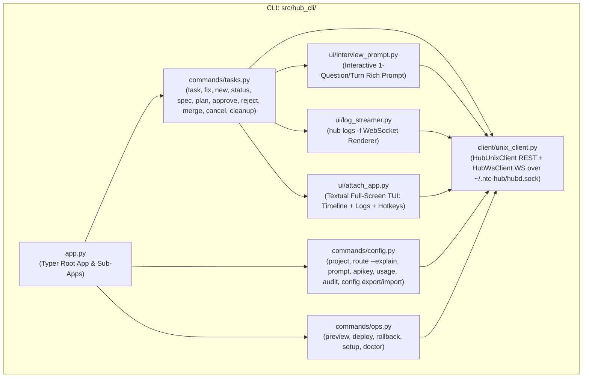
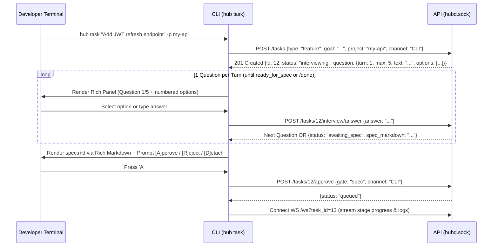
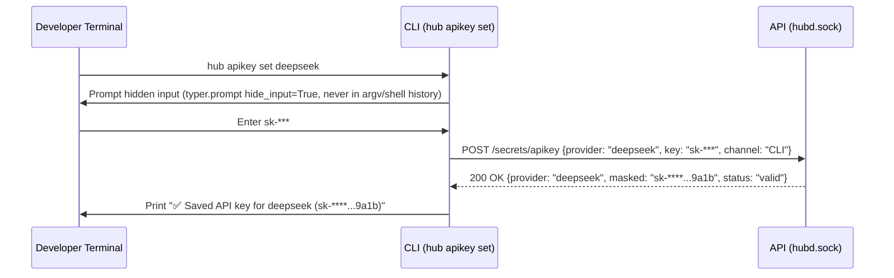

# Module Blueprint: CLI - hub Command-Line Interface & TUI Client

> **Module Code:** `CLI`  
> **Slug:** `hub-cli` (this file: `docs/plans/modules/hub-cli.md`)  
> **Code Root:** `src/hub_cli/`  
> **Project Roadmap:** `docs/plans/system-roadmap.md#2-module-registry`  
> **Contract Registry:** `docs/plans/contract-registry.md`  
> **Status:** `READY`  
> **Last Updated:** 2026-10-24 15:20  

<!--
STRUCTURE INVARIANTS (checked by scripts/validate-plans.ps1):
- Keep the section heading "## 7. Module Phase Sequence" and its table columns "Phase" and "Status".
- Phase IDs must match <MOD>-P<NN>; statuses: PENDING | ACTIVE | BLOCKED | COMPLETED.
- Every contract ID in §5 and §6 must exist in docs/plans/contract-registry.md.
-->

---

## 1. Module Charter
- **Responsibility:** Provide the thin command-line (`hub`) and terminal user interface (`hub attach`) client for the developer (`ARCH §3`, `SPEC M1–M5`). Communicates exclusively with `hubd` (`API`) over the local Unix domain socket (`~/.ntc-hub/hubd.sock` via `CT-API-01` and `CT-API-02`) to submit `task`/`fix`/`new`, conduct interactive 1-question/turn terminal interviews, stream live container logs (`hub logs -f`), inspect artifacts (`hub spec`, `hub plan`), resolve approval gates (`hub approve`, `hub reject`), trigger PR merge (`hub merge`) and worktree cleanup (`hub cleanup`), configure projects/routes/prompts/API keys/YAML export-import, run preview/deploy/rollback, and execute `hub setup` and `hub doctor`.
- **In Scope:**
  - `HubUnixClient` (`httpx.AsyncClient(transport=httpx.AsyncHTTPTransport(uds="~/.ntc-hub/hubd.sock"))`) and `HubWsClient` (`websockets.unix_connect("~/.ntc-hub/hubd.sock")`) with clean daemon-unreachable error handling (`AC-M1-01.3`).
  - **M1 Core Commands (`CLI-P01`):**
    - `hub task "<goal>" [-p <project>] [--auto] [--skip-interview] [--priority <level>]` (`US-M1-03`, `US-M1-06`).
    - `hub fix "<bug>" [-p <project>] [--auto]` (`US-M1-07`).
    - Interactive Terminal Interview Loop (`1 question/turn`, inline option numbering `[1..N]` + free-text reply, `/done` shortcut, `Ctrl+C` pause/resume hint) (`AC-M1-03.2..03.5`).
    - `hub status [<id>]` (Rich table of active/queued/awaiting tasks or detailed single-task stage timeline + PR link) (`US-M1-12`).
    - `hub logs <id> [--stage <stage>] [-f]` (historical log dump or live WebSocket stream with secret-redacted lines) (`US-M1-12`).
    - `hub attach <id>` (Textual full-screen TUI split view: Stage Timeline + Live Log Stream + Gate Approve/Reject/Merge hotkeys `a`/`r`/`m`/`q`, safe detach on `q`/`Ctrl+C` without killing background task) (`AC-M1-12.3`).
    - `hub approve <id> [spec|plan|deploy_prod]` & `hub reject <id> --note "<feedback>"` (`US-M1-08`).
    - `hub spec <id>` & `hub plan <id>` (Rich Markdown rendering of `spec.md` and `plan.md`, even when `--auto` was used) (`D-02`, `AC-M2-04.7`).
    - `hub merge <id>` (prints actionable failure reason if any of the 4 merge conditions fails) (`US-M1-11 🛡`).
    - `hub cancel <id>` & `hub cleanup [<id>]` (`US-M1-12`, `D-16`).
    - `hub project add|list|show|remove` (`US-M1-02`), `hub route list|set|preset` (`US-M1-13`), `hub prompt list|show|set|rollback` (`US-M1-14`), `hub audit [--limit N]` (`US-M1-15`), `hub doctor` (`US-M1-01`, `AC-M1-01.4`).
  - **M3 Commands (`CLI-P02`):**
    - `hub new <app-slug> "<goal>" [--template <tpl>] [--public]` (`US-M3-01`).
    - `hub apikey set <provider>` (hidden prompt via `typer.prompt(..., hide_input=True)`, never accepts plaintext key on CLI argv `AC-M3-03.1 🛡`) & `hub apikey list`.
    - `hub route set <stage> <harness>/<model> [--project 
] [--fallback <h/m>]` & `hub route --explain [--project 
]` (`US-M3-04`, `US-M3-08`).
    - `hub usage [--window 24h|7d|30d]` (`US-M3-07`).
  - **M4 Commands (`CLI-P03`):**
    - `hub config export [-o hub-config.yaml]` & `hub config import <file> [--dry-run]` (`US-M4-11 🛡`).
  - **M5 Commands (`CLI-P04`):**
    - `hub preview <id>` & `hub preview down <id>` (`US-M5-01` → `US-M5-03`).
    - `hub deploy <project> --env staging|prod [--task <id>]` & `hub rollback <project> --env staging|prod` (`US-M5-05`, `US-M5-06`).
    - `hub setup [--step <1..7>]` interactive terminal onboarding wizard (`US-M5-07`).
- **Out of Scope:**
  - Direct SQLite (`hub.db`) or `secrets.enc` file access (`CLI` must never import `CORE`, `ORCH`, `ADP`, `GIT`, or `DEP` directly; all actions go through `CT-API-01` and `CT-API-02`).
  - Spawning Docker containers or running `git` commands directly from the CLI process.
- **Primary Skills (`AI-skill-help.md`):** `python-cli-typer-rich`, `python-testing-patterns`.

---

## 2. Internal Component Diagram

---

## 3. Public Interface Inventory (Internal to Module)

| Component / Class | File Under `src/hub_cli/` | Purpose |
| :--- | :--- | :--- |
| `app` (`typer.Typer`) | `src/hub_cli/app.py` | Root CLI entrypoint registered as `hub` console script in `pyproject.toml`. |
| `HubUnixClient` | `src/hub_cli/client/unix_client.py` | Async HTTP/WS client over `~/.ntc-hub/hubd.sock` (`CT-API-01` & `CT-API-02`); maps HTTP errors & socket errors to Rich error panels + non-zero exit codes. |
| `run_terminal_interview()` | `src/hub_cli/ui/interview_prompt.py` | Interactive Rich loop displaying 1 question/turn with numbered choices or custom text, `/done` support, and final `spec.md` Markdown preview + Approve/Reject prompt. |
| `stream_task_logs()` | `src/hub_cli/ui/log_streamer.py` | Connects to `/ws?task_id=<id>` (`CT-API-02`), prints historical + live log lines with stage badges, exits cleanly on `Ctrl+C` without cancelling the task. |
| `HubAttachApp` (`textual.app.App`) | `src/hub_cli/ui/attach_app.py` | Full-screen Textual TUI for `hub attach <id>` with left stage list, right auto-scrolling log panel, and bottom keybinding bar (`a` approve, `r` reject, `m` merge, `q` detach). |
| `tasks_cmd` | `src/hub_cli/commands/tasks.py` | Implements `task`, `fix`, `new`, `status`, `logs`, `attach`, `spec`, `plan`, `approve`, `reject`, `merge`, `cancel`, `cleanup`. |
| `config_cmd` | `src/hub_cli/commands/config.py` | Implements `project`, `route` (including `--explain`), `prompt`, `apikey`, `usage`, `audit`, `config export/import`. |
| `ops_cmd` | `src/hub_cli/commands/ops.py` | Implements `preview`, `deploy`, `rollback`, `setup`, `doctor`. |

---

## 4. Data Ownership
- **Owned Stores / Tables / Collections:** None (`CLI` is a stateless thin client; all state lives in `CORE` behind `API`).
- **Read-Only Access:** Reads local YAML file path only when user passes `hub config import <file>` (`US-M4-11`) and writes exported YAML file on `hub config export -o <file>`.
- **Retention & Migration Policy:** None.

---

## 5. Contracts Provided
> `CLI` is a top-level user-facing leaf module and provides no inter-module contracts.

| Contract ID | Type | Summary | Spec Path | Consumers |
| :--- | :--- | :--- | :--- | :--- |
| *[None]* | — | — | — | — |

---

## 6. Contracts Consumed

| Contract ID | Provider | Usage in This Module | Failure / Fallback Policy |
| :--- | :--- | :--- | :--- |
| `CT-SYS-01` | `SYS` | Shared enums (`TaskStatus`, `BlockReason`, `StageName`, `ChannelSource`), exit code constants, and DTO models. | Strict schema validation. |
| `CT-API-01` | `API` | All `hub` CLI commands invoke `hubd` REST endpoints over `~/.ntc-hub/hubd.sock`. | If socket is missing or connection refused, print actionable Rich panel: `"hubd daemon is not running. Start with: systemctl start hubd or hubd serve"` and exit with code `2`. |
| `CT-API-02` | `API` | `hub logs -f <id>` and `hub attach <id>` subscribe to `/ws?task_id=<id>&since_event_id=<last_id>`. | Automatic exponential-backoff reconnect (`1s → 2s → 5s`) with `?since_event_id=` so no log line is missed during brief daemon restart. |

---

## 6b. Key Interaction Flows

### Flow 1: `hub task` + Interactive Terminal Interview + Live Progress (`CLI-P01` / `US-M1-03, US-M1-06`)

### Flow 2: `hub apikey set <provider>` Zero-Echo Secret Input (`CLI-P02` / `AC-M3-03.1 🛡`)

---

## 7. Module Phase Sequence

| Phase | Title | Objective | Aligns to GP | Depends On | Dossier | Status |
| :--- | :--- | :--- | :--- | :--- | :--- | :--- |
| `CLI-P01` | Core `hub` CLI (`task`, `fix`, Interview, `status`, `logs -f`, `attach` TUI, Gates, `merge`, `doctor`) | Build `HubUnixClient`/`HubWsClient`, all M1 commands + `hub spec`/`hub plan` viewers (`D-02`), Rich 1-question/turn interview UI, and Textual `hub attach` TUI | `GP-01` | `CT-SYS-01`, `CT-API-01`, `CT-API-02`, `API-P01` | — | `PENDING` |
| `CLI-P02` | `hub new`, Zero-Echo `hub apikey`, Scoped Routes (`--explain`) & `hub usage` | Add M3 greenfield app creation (`US-M3-01`), hidden-input API key setup (`AC-M3-03.1 🛡`), per-project route override + `--explain` (`US-M3-08`), and quota usage table (`US-M3-07`) | `GP-03` | `CLI-P01`, `API-P03` | — | `PENDING` |
| `CLI-P03` | Declarative Config Export & Import (`hub config export/import`) | Add `hub config export` and `hub config import [--dry-run]` with secret-inclusion rejection notice (`US-M4-11 🛡`) | `GP-04` | `CLI-P02`, `API-P04` | — | `PENDING` |
| `CLI-P04` | Preview, Deploy, Rollback & Interactive `hub setup` Wizard | Add `hub preview`, `hub preview down`, `hub deploy`, `hub rollback` (`deploy_prod` confirmation prompt 🔒), and 7-step `hub setup` wizard (`US-M5-01..07`) | `GP-05` | `CLI-P03`, `API-P05` | — | `PENDING` |

---

## 8. Module Invariants & Non-Functional Requirements
- **Performance:** Non-streaming CLI commands (`hub status`, `hub route list`, `hub project list`) complete and render output in `< 150ms` (`X-05`).
- **Security (`🛡`):**
  - `hub apikey set` and `hub setup` NEVER accept secret values via command-line flags/arguments (which would leak in `ps aux` and `~/.bash_history`); they strictly require interactive hidden prompt (`hide_input=True`) or stdin pipe (`AC-M3-03.1 🛡`, `X-01 🛡`).
  - `hub deploy <project> --env prod` always requires explicit confirmation (and `deploy_prod` gate approval) even if `--auto` was set on the task (`AC-M5-05.2 🔒`).
- **Resilience:** Pressing `Ctrl+C` or `q` during `hub logs -f <id>` or `hub attach <id>` cleanly closes the local WebSocket stream and prints `"Detached from task #<id> (task continues running in hubd)"` without cancelling the task (`AC-M1-12.3`).
- **Testing (`python-testing-patterns`):** Tested with `typer.testing.CliRunner` and Textual `app.run_test()` pilot against a mocked/in-memory `API` transport.

---

## 9. Risks & Open Questions
- **Terminal Encoding on Windows / SSH Sessions:** Rich console output must force `utf-8` (`sys.stdout.reconfigure(encoding="utf-8")`) so Vietnamese status labels and box-drawing characters render cleanly across Linux SSH, macOS, and Windows Terminal (`docs/patterns/encoding-invariants.md`).
