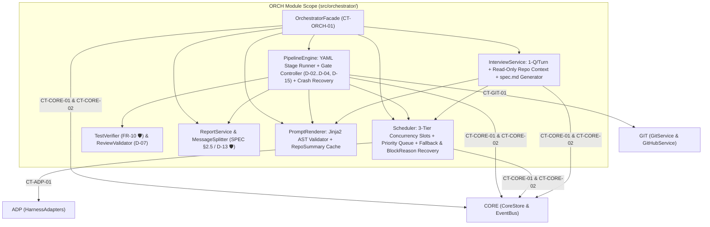

# Module Blueprint: ORCH - Pipeline Engine, Scheduler, Interview, Review & Report

> **Module Code:** `ORCH`  
> **Slug:** `orchestrator` (this file: `docs/plans/modules/orchestrator.md`)  
> **Code Root:** `src/orchestrator/`  
> **Project Roadmap:** `docs/plans/system-roadmap.md#2-module-registry`  
> **Contract Registry:** `docs/plans/contract-registry.md`  
> **Status:** `READY`  
> **Last Updated:** 2026-10-24 15:07  

<!--
STRUCTURE INVARIANTS (checked by scripts/validate-plans.ps1):
- Keep the heading "## 7. Module Phase Sequence" and its table header names.
- Phase IDs: <MOD>-P<NN> using this module's code. Dossier files: phase-<NN>-<slug>.md
- Phase status: PENDING | ACTIVE | BLOCKED | COMPLETED
  ACTIVE    -> dossier must exist in docs/plans/active/<module-slug>/
  COMPLETED -> dossier must exist in docs/plans/completed/<module-slug>/
- This blueprint must not contradict the Project Roadmap or the Contract Registry.
-->

---

## 1. Module Charter
- **Responsibility (one sentence):** Acts as the central brain of `hubd`, coordinating stateful 1-question-per-turn interviews (`InterviewService`), multi-level concurrency & quota scheduling (`Scheduler`), YAML pipeline execution with independent test verification and structured review validation (`PipelineEngine`), and concise §2.5 multi-part report generation (`ReportService` & `MessageSplitter` `🛡 Anti-Goal #2`).
- **Bounded Context / Ubiquitous Language:** Stateful Interview (`InterviewService`), Slot & Quota Scheduler (`Scheduler`), Stage Execution Engine (`PipelineEngine`), Independent Hub Test Verification (`verify_project_tests`), Structured Review Consistency Override (`ReviewValidator` `D-07`), Bounded Fix Loop & Error Signature (`D-08`, `AC-M1-10.3`), Smart Message Splitter (`MessageSplitter` `SPEC §2.5`).
- **In-Scope:**
  - [ ] Codify `CT-ORCH-01` (`contracts/orchestrator/orchestrator-protocol.py`).
  - [ ] Implement `InterviewService` (`ARCH §8`, `US-M1-03`, `US-M2-03`, `US-M3-01`): read-only repo inspection for `task`/`fix` (`AC-M1-03.2`), strictly 1 primary question per turn (`AC-M1-03.3`) with up to 3 suggestion chips (`D-09`), periodic summary every ≤ 5 turns & explicit default selection on `"tuỳ bạn"` (`AC-M1-03.4`), and `.hub/spec.md` 8-section generation/validation (`SPEC §2.3`, `AC-M1-03.5/03.8`).
  - [ ] Implement Jinja2 prompt rendering and static variable validation (`{{spec}}`, `{{plan}}`, `{{repo_summary}}`, `{{test_report}}`, `{{review}}`, `{{round}}`, `{{project.*}}`, `{{task.*}}` — `US-M1-04`).
  - [ ] Implement `Scheduler` (`ARCH §7`, `US-M1-14`, `US-M3-04..06`): 3-tier concurrency slots (`global.max_tasks_running`, `harness.max_concurrent`, `(harness, model).max_concurrent`), priority queue (`in-progress > new`, `fix > task/new`, FIFO), route fallback switching, automatic `rate_limit` (`rate_limited_until`) & `auth_expired` (`D-05`) recovery, and commit-keyed `repo_summary` caching (`US-M3-09`).
  - [ ] Implement `PipelineEngine` (`ARCH §5`, `US-M1-06..10`, `US-M1-12..13`): YAML pipelines (`feature.yaml`, `fix.yaml`), artifact handoff in `.hub/`, independent `project.test_cmd` verification (`US-M1-08 🛡`), `ReviewValidator` (`D-07`, `US-M1-09`), bounded fix loop (`max_rounds=3`, repeated error signature early-stop `AC-M1-10.3`, session reuse `resume_session_id`), approval gates (`spec`, `plan`, `merge`, `/auto on` `D-02`, `D-03`, `D-04`, `D-15`), and startup crash recovery (`US-M1-13`).
  - [ ] Implement `ReportService` & `MessageSplitter` (`ARCH §14`, `SPEC §2.5`, `D-13`, `US-M1-16 🛡`, `US-M2-06 🛡`): build ground-truth reports (PR markdown, Webapp view, and ≤10-line Telegram Part 1 + ≤15-line / ≤3,500-char Parts 2..5 without mid-sentence/code/URL splits).
- **Out-of-Scope (owned elsewhere):**
  - Low-level SQLite tables and `secrets.enc` encryption → `CORE`
  - Spawning `docker run` or parsing raw CLI JSON streams → `ADP`
  - Executing `git push` or GitHub REST API calls → `GIT`
  - Managing preview containers, Caddy routes, or Vercel/Cloudflare deployments → `DEP`

## 2. Tech Stack & Runtime
- **Language / Runtime:** Python 3.12+ (`asyncio`).
- **Frameworks & Libraries:** `Jinja2` (sandboxed prompt template rendering & AST variable validation), `PyYAML`, `pydantic>=2.7`.
- **Storage:** Reads/writes task artifacts inside `<worktree>/.hub/` (`spec.md`, `plan.md`, `test-report.md`, `review.json`, `REPORT.md`) and repo summaries in `~/.ntc-hub/cache/repo-summary/<slug>/<sha>.md`; persists all state via `CORE` (`CT-CORE-01`).
- **AI Skills Activated (`AI-skill-help.md`):**
  - [`ntchub-pipeline-report`](file:///d:/vibe-code/ntc-ai-center-hub/.agents/skills/ntchub-pipeline-report/SKILL.md) — 1-question/turn interview, `D-07` review override, `D-08` fix loop + error signature early-stop, §2.5 message splitter (`🛡`).
  - [`grill-me`](file:///d:/vibe-code/ntc-ai-center-hub/.agents/skills/grill-me/SKILL.md) & [`skill-creator`](file:///d:/vibe-code/ntc-ai-center-hub/.agents/skills/skill-creator/SKILL.md) — Designing default 8-role Jinja2 prompts and interview decision trees.
  - [`python-testing-patterns`](file:///d:/vibe-code/ntc-ai-center-hub/.agents/skills/python-testing-patterns/SKILL.md) — `FakeHarness` pipeline integration tests, independent `test_cmd` verification tests (`AC-M1-08 🛡`), §2.5 message splitter torture tests (`AC-M1-16.4 🛡`).
- **Build / Test Commands:** `pytest tests/orchestrator -q`

## 3. Internal Architecture


## 4. Data Ownership
| Entity / Artifact | Key Attributes | Storage | Notes |
| :--- | :--- | :--- | :--- |
| `.hub/spec.md` | 8 mandatory sections (`Mục tiêu`, `Phạm vi`, `Ngoài phạm vi`, `Tiêu chí chấp nhận`, `Ràng buộc kỹ thuật`, `Lệnh test`, `Deploy target`, `Repo`) | `<worktree>/.hub/spec.md` | Contract between `interview` and downstream stages (`SPEC §2.3`, `FR-5`). |
| `.hub/plan.md` | Numbered implementation steps & architecture notes | `<worktree>/.hub/plan.md` | Produced by `plan` role; versioned per feedback round (`FR-12`). |
| `.hub/test-report.md` | Agent test mapping + Hub's independent `test_cmd` exit code, pass/fail counts, and normalized error signature | `<worktree>/.hub/test-report.md` | Hub's own `test_cmd` execution is the sole source of truth (`FR-10 🛡`). |
| `.hub/review.json` | `verdict` (`approve \| changes_requested`), `issues[{severity, file, line, note}]` | `<worktree>/.hub/review.json` | Validated and normalized by `ReviewValidator` (`D-07`, `US-M1-09`). |
| `.hub/REPORT.md` | Full Markdown report (also used as GitHub PR description) | `<worktree>/.hub/REPORT.md` | Attached when `/report` or Part 5 overflow requires full file (`FR-37`). |

## 5. Interfaces
### 5.1 Provided Contracts
| Contract ID | Type | Purpose | Consumers |
| :--- | :--- | :--- | :--- |
| `CT-ORCH-01` | Library | `Orchestrator` (`create_task`, `submit_interview_message`, `finalize_spec_go`, `resolve_approval_gate`, `set_task_auto`, `pause_task`, `resume_task`, `cancel_task`, `merge_task`, `get_artifact_view`, `recover_on_startup`), `Scheduler` (`run_forever`, `get_slot_status`), `MessageSplitter` (`split_message`), and `PipelineValidator` (`validate_pipeline_yaml`). | `API` |

### 5.2 Consumed Contracts
| Contract ID | Provider | Purpose | Required By Phase |
| :--- | :--- | :--- | :--- |
| `CT-SYS-01` | `SYS` | Domain enums and default YAML pipelines / Jinja2 prompts | `ORCH-P01` |
| `CT-CORE-01` | `CORE` | Persist task/stage/agent/approval/interview records and resolve routes (`task → project → global`) | `ORCH-P01` → `ORCH-P04` |
| `CT-CORE-02` | `CORE` | Publish task, stage, approval, and log stream events | `ORCH-P01` → `ORCH-P04` |
| `CT-ADP-01` | `ADP` | Run headless coding agents and independent `test_cmd` verification inside `ntchub-agent` | `ORCH-P01`, `ORCH-P03` |
| `CT-GIT-01` | `GIT` | Manage worktrees, verify untampered state, commit/push stages, create repos/PRs, and execute 4-condition merge | `ORCH-P01`, `ORCH-P03` |

### 5.3 Events
- **Published (via `CT-CORE-02`):** Triggers `task.status_changed`, `stage.started`, `stage.completed`, `approval.requested`, `approval.resolved`, and live agent event forwarding.
- **Subscribed (`CT-CORE-02`):** `Scheduler` subscribes to `harness.status_changed` and `task.status_changed` to wake up immediately when a slot frees or `/login` unblocks `auth_expired` tasks.

## 6. Core Flows

### Flow 1: Stage Execution, Independent Test Verification, Review `D-07` & Bounded Fix Loop (`ORCH-P01`)
```mermaid
sequenceDiagram
    participant Pipe as ORCH PipelineEngine
    participant Sched as ORCH Scheduler
    participant Adp as ADP (HarnessAdapter)
    participant Ver as ORCH TestVerifier & ReviewValidator 🛡
    participant Git as GIT (GitService)
    participant Core as CORE (CoreStore)

    Pipe->>Core: create_stage_run(status='pending')
    Pipe->>Sched: acquire_slot(role, harness, model)
    Sched-->>Pipe: Slot granted
    Pipe->>Adp: run(RunRequest(workdir, model, rendered_prompt, mode, resume_session_id))
    Adp-->>Pipe: AgentEvent stream -> Done(session_id, exit_code)
    Pipe->>Sched: release_slot()
    alt Stage == 'test' (verify: project.test_cmd)
        Pipe->>Ver: run_independent_hub_test(workdir, project.test_cmd) (AC-M1-08.1 🛡)
        Ver->>Adp: Execute project.test_cmd in clean container (ignore agent's self-reported pass)
        Ver-->>Pipe: HubTestResult(passed, pass_count, fail_count, error_signature)
    else Stage == 'review'
        Pipe->>Git: Revert any edits outside .hub/review.json (AC-M1-09.4)
        Pipe->>Ver: validate_review_json(workdir / '.hub/review.json')
        Note over Ver: Retry once if invalid JSON; override 'approve' -> 'changes_requested' if >=1 blocker/major or >=3 minor (D-07)
        Ver-->>Pipe: NormalizedReview(verdict, issues)
    end
    Pipe->>Git: commit_and_push_stage(task_id, stage, round)
    alt test failed OR review == 'changes_requested'
        Pipe->>Pipe: Check round < max_rounds (3) AND error_signature != prev_error_signature (AC-M1-10.2, 10.3)
        Pipe->>Pipe: Loop -> fix (round + 1) -> test -> review
    else Both passed
        Pipe->>Pipe: Advance to report -> merge gate (or auto-merge if eligible per D-15 & AC-M1-08.5 🛡)
    end
```

### Flow 2: Smart Multi-Part Report Generation (`ORCH-P01` / `SPEC §2.5`, `D-13 🛡`)
```mermaid
sequenceDiagram
    participant Pipe as ORCH PipelineEngine
    participant Rpt as ORCH ReportService
    participant Splt as ORCH MessageSplitter 🛡
    participant Core as CORE EventBus

    Pipe->>Rpt: generate_task_report(task_id)
    Rpt->>Rpt: Collect structured ground truth (duration, PR URL, hub test counts, review verdict, token/turn usage)
    Rpt->>Rpt: Run 'report' role for concise 'Đã làm' & 'Cần bạn xem' items; write full .hub/REPORT.md
    Rpt->>Splt: split_telegram_message(summary_header, sections)
    Note over Splt: Part 1: strictly <= 10 lines, self-contained, carries [Preview][Merge][Chi tiết] buttons.<br/>Parts 2..5: <= 15 lines & <= 3,500 chars; split by section -> bullet -> sentence; never mid-code/URL.
    Splt-->>Rpt: List[TelegramMessagePart] (1..5 parts)
    Rpt->>Core: Save REPORT.md artifact & emit completion event with message parts
```

## 7. Module Phase Sequence

| Phase | Title | Objective | Aligns to GP | Depends On | Dossier | Status |
| :--- | :--- | :--- | :--- | :--- | :--- | :--- |
| `ORCH-P01` | Contract (`CT-ORCH-01`), Interview, Scheduler, Pipeline Engine, Review `D-07`, Fix Loop & §2.5 Splitter | Codify `CT-ORCH-01`, implement `InterviewService`, Jinja2 prompt engine, M1 `Scheduler`, `PipelineEngine` (`task`/`fix`), independent `test_cmd` verifier (`🛡`), `ReviewValidator` (`D-07`), fix loop (`D-08`), crash recovery, and `ReportService` + `MessageSplitter` (`🛡`) | `GP-01` | `CT-SYS-01`, `CT-CORE-01`, `CT-CORE-02`, `CT-ADP-01`, `CT-GIT-01` | — | `PENDING` |
| `ORCH-P02` | Telegram Suggestion Chips (`D-09`), `/spec` & `/plan` On-Demand Viewers (`D-02`) & Gate Feedback | Add inline suggestion generation for interviews, `/spec` & `/plan` viewers under `/auto on` (`AC-M2-04.7`), and gate comment loop (`D-03`) | `GP-02` | `ORCH-P01` | — | `PENDING` |
| `ORCH-P03` | `/new` Pipeline, Route Fallbacks, `block_reason` Auto-Recovery, Per-Model Slots & Repo Summary Cache | Add `new` app workflow (`US-M3-01`), ordered route fallbacks (`US-M3-04`), automatic `rate_limited_until` wakeup (`US-M3-05`), `(harness, model)` concurrency caps (`US-M3-06`), quota stats (`US-M3-07`), scoped routes (`US-M3-08`), and commit-keyed `repo_summary` cache (`US-M3-09`) | `GP-03` | `ORCH-P02`, `ADP-P02`, `GIT-P02` | — | `PENDING` |
| `ORCH-P04` | Custom YAML Pipeline Validator & `D-15` Auto-Merge Guard | Validate Webapp pipeline edits (`US-M4-06`) and enforce `D-15` (tasks with disabled `test` or `review` stage never auto-merge) | `GP-04` | `ORCH-P03` | — | `PENDING` |

## 8. Module Invariants & Non-Functional Requirements
- **Performance:** Scheduler dispatches a queued task within `≤ 1s` (well under the `≤ 5s` limit of `AC-M1-14.2`) when a slot becomes free.
- **Security & Anti-Goal Guarantees (`🛡`):**
  - **Independent Test Truth (`AC-M1-08.1..08.5 🛡`):** `PipelineEngine` never trusts the agent's text output for test results; it always executes `project.test_cmd` itself and blocks auto-merge whenever `project.test_cmd` is empty or `test`/`review` stage was skipped (`D-15`).
  - **Message Splitter Torture Proof (`AC-M1-16.4 🛡`):** `MessageSplitter` is pure, deterministic, and verified against 50+ items, 2,000-char bullets, fenced code blocks, and long URLs to guarantee Part 1 ≤ 10 lines and 100% character preservation across parts.
- **Resilience:** `recover_on_startup()` (`AC-M1-13.1`) resets any interrupted `running` task's worktree to the last `hub(<id>): ...` commit and requeues that exact stage without losing prior completed stages.
- **Observability:** Every stage transition, fallback switch, and gate decision logs structured context and emits a `CT-CORE-02` event.

## 9. Risks & Open Questions
- **Deadlock Prevention in 3-Tier Slot Scheduling (`US-M3-06`):** To prevent a task from holding a `global` slot while waiting for a `(harness, model)` slot, `Scheduler.acquire_slot()` acquires `(global, harness, harness+model)` atomically in a single in-memory check before marking the stage `running`; tasks waiting in `waiting_approval`, `awaiting_merge`, `paused`, `rate_limited`, or `interviewing` hold zero slots (`SPEC §2.1`).
