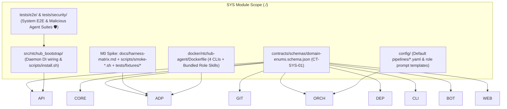
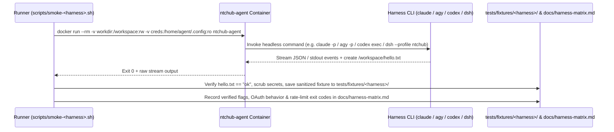
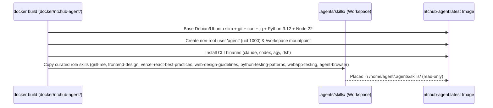
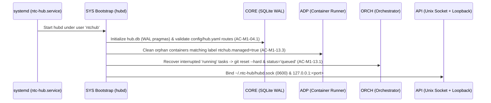

# Module Blueprint: SYS - System & Cross-Cutting Infrastructure

> **Module Code:** `SYS`  
> **Slug:** `system` (this file: `docs/plans/modules/system.md`)  
> **Code Root:** `./` (`contracts/`, `docker/`, `scripts/`, `config/`, `tests/`, `pyproject.toml`)  
> **Project Roadmap:** `docs/plans/system-roadmap.md#2-module-registry`  
> **Contract Registry:** `docs/plans/contract-registry.md`  
> **Status:** `READY`  
> **Last Updated:** 2026-10-24 14:57  

<!--
STRUCTURE INVARIANTS (checked by scripts/validate-plans.ps1):
- Keep the heading "## 7. Module Phase Sequence" and its table header names.
- Phase IDs: <MOD>-P<NN> using this module's code. Dossier files: phase-<NN>-<slug>.md
- Phase status: PENDING | ACTIVE | BLOCKED | COMPLETED
  ACTIVE    -> dossier must exist in docs/plans/active/<module-slug>/
  COMPLETED -> dossier must exist in docs/plans/completed/<module-slug>/
- This blueprint must not contradict the Project Roadmap or the Contract Registry.
-->

---

## 1. Module Charter
- **Responsibility (one sentence):** Owns cross-cutting shared schemas (`CT-SYS-01`), the M0 headless harness verification spike, the isolated `ntchub-agent` sandbox Docker image (with bundled role AI skills), repository packaging/installation scripts, daemon wiring, and system-wide E2E/security regression suites.
- **Bounded Context / Ubiquitous Language:** Shared Domain Vocabulary (`TaskKind`, `TaskStatus`, `BlockReason`, `RoleName`, `GateName`, `DeployTargetType`), Sandbox Container Image (`ntchub-agent`), Headless Harness Matrix (`claude`, `codex`, `agy`, `dsh`), System Bootstrap (`hubd` entrypoint & `systemd` unit).
- **In-Scope:**
  - [ ] Codify shared cross-module enums and JSON schemas (`CT-SYS-01` at `contracts/schemas/domain-enums.schema.json`).
  - [ ] Execute **M0 Spike** (`US-M0-01` → `US-M0-03`): verify headless CLI flags, non-browser OAuth login procedures, `dsh` API-key profile isolation, `docs/harness-matrix.md`, `scripts/smoke-<harness>.sh`, and real output fixtures in `tests/fixtures/<harness>/`.
  - [ ] Build and harden the `ntchub-agent` Docker image (`docker/ntchub-agent/Dockerfile`) bundling the 4 harness CLIs and relevant `.agents/skills/` for the 8 agent roles (`interview`, `plan`, `code`, `reproduce`, `test`, `review`, `fix`, `report`).
  - [ ] Provide Python workspace packaging (`pyproject.toml`), default config/prompt templates (`config/`), single-command Linux VPS / WSL2 installer (`scripts/install.sh`), and `systemd` service definition (`US-M1-01`).
  - [ ] Wire `hubd` daemon startup and cross-module E2E / malicious-agent security regression suites (`SPEC §10`, `X-01 🛡` → `X-08`).
- **Out-of-Scope (owned elsewhere):**
  - SQLite persistence (`hub.db`), `secrets.enc` encryption, and `EventBus` implementation → `CORE`
  - Python `HarnessAdapter` runtime classes and stream-JSON parser logic → `ADP`
  - Git worktree management, push guards, and GitHub API calls → `GIT`
  - Pipeline state machine, scheduler, interview, review validator, and §2.5 message splitter → `ORCH`
  - Preview container orchestration, Caddy routing, and Cloudflare Tunnel runtime manager → `DEP`
  - FastAPI REST/WebSocket routes → `API`
  - `hub` CLI commands → `CLI`
  - Telegram bot handlers → `BOT`
  - React SPA frontend → `WEB`

## 2. Tech Stack & Runtime
- **Language / Runtime:** Python 3.12+, Bash / PowerShell (operational & smoke scripts), Docker Engine (Linux / WSL2).
- **Frameworks & Libraries:** `pydantic>=2.7` (schema generation & validation), `jsonschema`, `pytest`, `pytest-asyncio`, `uv` / `pipx` for packaging.
- **Storage:** File-system artifacts only (`contracts/`, `docs/harness-matrix.md`, `tests/fixtures/<harness>/`, `config/`). Owns no database tables.
- **AI Skills Activated (`AI-skill-help.md`):**
  - [`ntchub-harness-adapters`](file:///d:/vibe-code/ntc-ai-center-hub/.agents/skills/ntchub-harness-adapters/SKILL.md) — M0 CLI headless flags, OAuth vs API key rules.
  - [`docker-container-security`](file:///d:/vibe-code/ntc-ai-center-hub/.agents/skills/docker-container-security/SKILL.md) — `ntchub-agent` non-root user, volume whitelist, CPU/RAM/PID limits (`🛡`).
  - [`python-testing-patterns`](file:///d:/vibe-code/ntc-ai-center-hub/.agents/skills/python-testing-patterns/SKILL.md) — M0 fixtures, malicious agent E2E regression tests (`🛡`).
  - [`felo-search`](file:///d:/vibe-code/ntc-ai-center-hub/.agents/skills/felo-search/SKILL.md) & [`felo-web-fetch`](file:///d:/vibe-code/ntc-ai-center-hub/.agents/skills/felo-web-fetch/SKILL.md) — Live CLI documentation verification for `claude`, `codex`, `agy`, `dsh`.
  - [`skill-creator`](file:///d:/vibe-code/ntc-ai-center-hub/.agents/skills/skill-creator/SKILL.md) — Curating role prompts and bundling `.agents/skills/` into `ntchub-agent`.
- **Build / Test Commands:**
  - Plan validation: `powershell -NoProfile -ExecutionPolicy Bypass -File scripts/validate-plans.ps1`
  - Schema & system unit tests: `pytest tests/system -q`
  - M0 smoke suite: `bash scripts/smoke-all.sh` (or per-harness `scripts/smoke-<harness>.sh`)

## 3. Internal Architecture

## 4. Data Ownership
| Entity / Artifact | Key Attributes / Contents | Storage | Notes |
| :--- | :--- | :--- | :--- |
| `domain-enums.schema.json` | `TaskKind`, `TaskStatus`, `BlockReason`, `RoleName`, `GateName`, `DeployTargetType`, `ApprovalStatus`, `StageStatus` | `contracts/schemas/domain-enums.schema.json` | Single source of truth for domain enums (`CT-SYS-01`). |
| `harness-matrix.md` | Exact CLI flags, model flags, JSON output format, session resume, auth-expiry exit behavior, rate-limit signatures for `claude`, `codex`, `agy`, `dsh` | `docs/harness-matrix.md` | Deliverable of `US-M0-01` → `US-M0-03`. |
| Harness Fixtures | Sanitized real stdout/stream-JSON samples (`success.jsonl`, `rate_limited.jsonl`, `auth_expired.jsonl`, `error.jsonl`) | `tests/fixtures/<harness>/` | Consumed by `ADP` parser unit tests (`AC-M0-01.3`, `AC-M1-05.4`). |
| `ntchub-agent` Image | Non-root `agent` user (`uid 1000`), `claude`, `codex`, `agy`, `dsh` binaries, curated `.agents/skills/` | `docker/ntchub-agent/Dockerfile` | Ephemeral container image spawned by `ADP` (`AC-M1-05.2 🛡`). |
| Default Config & Prompts | `feature.yaml`, `fix.yaml`, Jinja2 templates for 8 roles (`interview`, `plan`, `code`, `reproduce`, `test`, `review`, `fix`, `report`) | `config/pipelines/`, `config/prompts/` | Seeded into `~/.ntc-hub/config/` on install (`US-M1-04`, `US-M1-06`). |

## 5. Interfaces
### 5.1 Provided Contracts
| Contract ID | Type | Purpose | Consumers |
| :--- | :--- | :--- | :--- |
| `CT-SYS-01` | Schema | Canonical JSON Schema + Python/TypeScript enum definitions for `TaskKind`, `TaskStatus`, `BlockReason` (`rate_limit \| auth_expired`), `RoleName`, `GateName`, `DeployTargetType`, `StageStatus`, `ApprovalStatus`. | `CORE`, `ADP`, `GIT`, `ORCH`, `DEP`, `API`, `CLI`, `BOT`, `WEB` |

### 5.2 Consumed Contracts
| Contract ID | Provider | Purpose | Required By Phase |
| :--- | :--- | :--- | :--- |
| `CT-CORE-01` | `CORE` | Wire SQLite store, config, and encrypted secrets into `hubd` bootstrap and E2E tests | `SYS-P02` |
| `CT-ADP-01` | `ADP` | Wire `ClaudeCodeAdapter`, `AntigravityAdapter`, `FakeHarness` (M1) and `CodexAdapter`, `DeepSeekHarnessAdapter` (M3) | `SYS-P02`, `SYS-P04` |
| `CT-GIT-01` | `GIT` | Wire `GitService` & `GitHubService` into `hubd` and run malicious-agent git safety regression suite | `SYS-P02`, `SYS-P04` |
| `CT-ORCH-01` | `ORCH` | Wire `Orchestrator`, `Scheduler`, `InterviewService`, `ReportService` into `hubd` | `SYS-P02` |
| `CT-API-01` | `API` | Run system-level E2E tests through `hubd` REST socket/loopback endpoints | `SYS-P02` → `SYS-P06` |
| `CT-API-02` | `API` | Verify cross-channel WebSocket event sync (`X-08`) in E2E tests | `SYS-P03` → `SYS-P06` |
| `CT-DEP-01` | `DEP` | Verify Cloudflare Tunnel + Access (`D-17`) and preview/deploy E2E flows | `SYS-P05`, `SYS-P06` |

### 5.3 Events
- **Published:** None directly (events are published by `CORE`/`ORCH`/`API`).
- **Subscribed:** Subscribes to `CT-API-02` in E2E test suites to assert `≤ 3s` multi-channel synchronization (`X-08`).

## 6. Core Flows

### Flow 1: M0 Headless Harness Verification & Fixture Capture (`SYS-P01` / `GP-00`)

- **Business invariants:**
  - Every harness must be invoked strictly via its official CLI binary (`FR-15a 🛡`), never via Python/Node SDKs.
  - OAuth credential expiration in headless mode must fail fast in `≤ 30 seconds` (`AC-M0-02.3`), never hang waiting for interactive input.
  - API keys are tested exclusively with `dsh --profile ntchub` via environment variables and verified absent from `/workspace` (`AC-M0-03.2 🛡`).

### Flow 2: `ntchub-agent` Container Image Build with Bundled Role Skills (`SYS-P01` & `SYS-P02`)

- **Failure handling:** Image build verifies binary `--version` for each installed CLI and non-root execution (`whoami == agent`).

### Flow 3: `hubd` Bootstrap, Crash Recovery & Malicious-Agent E2E Gate (`SYS-P02` / `GP-01`)

## 7. Module Phase Sequence

| Phase | Title | Objective | Aligns to GP | Depends On | Dossier | Status |
| :--- | :--- | :--- | :--- | :--- | :--- | :--- |
| `SYS-P01` | Shared Schema (`CT-SYS-01`) & M0 Harness Spike | Codify `CT-SYS-01` (`domain-enums.schema.json`), build base `ntchub-agent` Dockerfile, verify `claude`, `codex`, `agy`, `dsh` headless CLIs (`docs/harness-matrix.md`, `scripts/smoke-*.sh`, `tests/fixtures/*`) | `GP-00` | — | — | `PENDING` |
| `SYS-P02` | M1 Packaging, Default Prompts, Daemon Bootstrap & Security Suite | Workspace `pyproject.toml`, default YAML pipelines & 8-role Jinja2 prompts, `scripts/install.sh` + `systemd` unit, `hubd` DI wiring, and M1 E2E + malicious-agent security suite (`🛡`) | `GP-01` | `SYS-P01`, `CT-CORE-01`, `CT-ADP-01`, `CT-GIT-01`, `CT-ORCH-01`, `CT-API-01` | — | `PENDING` |
| `SYS-P03` | M2 Cross-Channel Sync & Telegram Security E2E | Wire `BOT` into `hubd`, verify CLI ↔ Telegram gate sync (`≤ 3s`) and non-owner / private-secret deletion E2E tests (`🛡`) | `GP-02` | `SYS-P02`, `CT-API-02` | — | `PENDING` |
| `SYS-P04` | M3 Multi-Harness (`codex`, `dsh`) & New-Repo E2E | Update `ntchub-agent` image for `codex` & `dsh` profile, verify J1 `/new` E2E, fallback routing, and `block_reason` auto-recovery | `GP-03` | `SYS-P03` | — | `PENDING` |
| `SYS-P05` | M4 Webapp Static Serving & Tunnel Access Verification | Bundle `WEB` static build into `hubd`, verify Cloudflare Access edge blocking (`AC-M4-01.5 🛡`) and Webapp ↔ Telegram sync | `GP-04` | `SYS-P04`, `CT-DEP-01` | — | `PENDING` |
| `SYS-P06` | M5 Preview/Deploy E2E & Full Multi-Channel Setup | Full J1 E2E (`new` → `preview` → `merge` → `deploy prod` → `rollback`), zero-open-port scan (`AC-M5-01.5 🛡`), and `/setup` acceptance suite | `GP-05` | `SYS-P05` | — | `PENDING` |

## 8. Module Invariants & Non-Functional Requirements
- **Performance:** `hubd` startup (including crash recovery and orphan container cleanup) completes in `< 5 seconds`.
- **Security (`🛡`):**
  - `ntchub-agent` runs as unprivileged user `agent`; never contains or mounts `~/.ntc-hub/secrets.enc`, `hub.db`, `hubd.sock`, `~/.ssh`, or `/var/run/docker.sock` (`AC-M1-05.2`, `AC-M1-05.3`).
  - Post-E2E secret scanner (`X-01 🛡`) greps all `logs/` and SQLite tables (outside `secrets.enc`) for test secret tokens and asserts `0` matches.
- **Resilience:** `ntc-hub.service` uses `Restart=on-failure` and `KillMode=process` (or cleans up labeled containers on boot) so restarts never corrupt task worktrees (`US-M1-13`).
- **Observability:** Structured JSON/text logging per `task/stage/attempt` and `scripts/validate-plans.ps1` structural check green at every phase boundary.

## 9. Risks & Open Questions
- **Local Environment Availability during `SYS-P01` (M0):** On a machine where one of the 4 CLI binaries (`claude`, `codex`, `agy`, `dsh`) is not yet installed or logged in, `scripts/smoke-<harness>.sh` must support a `--dry-run / --mock-binary` mode for CI validation while documenting real CLI verification steps in `docs/harness-matrix.md`.
