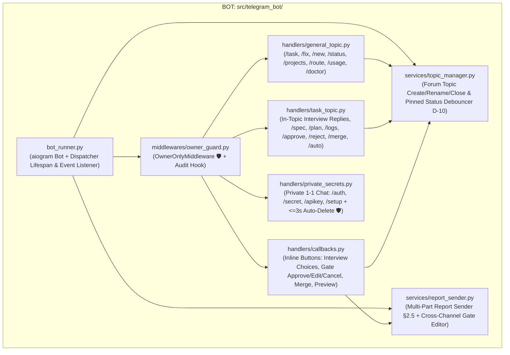
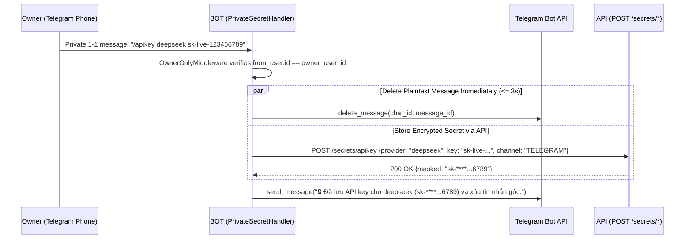
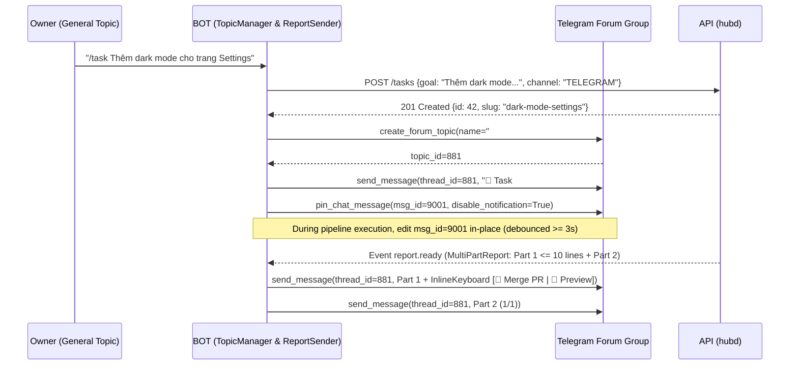

# Module Blueprint: BOT - aiogram 3 Telegram Forum Topics Gateway

> **Module Code:** `BOT`  
> **Slug:** `telegram-bot` (this file: `docs/plans/modules/telegram-bot.md`)  
> **Code Root:** `src/telegram_bot/`  
> **Project Roadmap:** `docs/plans/system-roadmap.md#2-module-registry`  
> **Contract Registry:** `docs/plans/contract-registry.md`  
> **Status:** `READY`  
> **Last Updated:** 2026-10-24 15:24  

<!--
STRUCTURE INVARIANTS (checked by scripts/validate-plans.ps1):
- Keep the section heading "## 7. Module Phase Sequence" and its table columns "Phase" and "Status".
- Phase IDs must match <MOD>-P<NN>; statuses: PENDING | ACTIVE | BLOCKED | COMPLETED.
- Every contract ID in §5 and §6 must exist in docs/plans/contract-registry.md.
-->

---

## 1. Module Charter
- **Responsibility:** Provide the mobile-first Telegram gateway (`aiogram 3`) enabling the owner to manage all development pipelines, interviews, approval gates, secrets, previews, and production deployments 100% from a phone (`ARCH §1, §10`, `SPEC M2, M3, M5`). Organizes tasks into dedicated Telegram Forum Topics (`#<id> · <slug>`), enforces strict `owner_user_id` security filtering (`🛡`), auto-deletes secret messages in private chat within `≤ 3s` (`🛡`), edits pinned status cards in-place (`D-10`), and delivers unbroken multi-part reports (`SPEC §2.5`, `D-13`).
- **In Scope:**
  - **Owner Security Middleware (`OwnerOnlyMiddleware`, `US-M2-01 🛡`):**
    - Outermost `aiogram` middleware on both `dp.message` and `dp.callback_query` that drops any event where `from_user.id != config.telegram.owner_user_id` without replying (`AC-M2-01.1 🛡`) and records `unauthorized_telegram_access` in the audit log (`AC-M2-01.2 🛡`).
    - Group chat ID verification (`chat.id == config.telegram.group_chat_id` for Forum Topic commands; private chat `chat.type == "private"` allowed strictly for secret intake and `/setup`).
  - **Forum Topics Lifecycle & Routing (`US-M2-02`):**
    - General Topic (`message_thread_id is None` or General thread): accepts `/task`, `/fix`, `/new`, `/status`, `/projects`, `/route`, `/usage`, `/doctor` and posts cross-task summaries.
    - Task Topic (`#<id> · <slug>`): automatically created via `bot.create_forum_topic()` when a task starts (`AC-M2-02.1`), stores `topic_id` + `pinned_msg_id` on `TASK`, routes in-topic commands (`/status`, `/spec`, `/plan`, `/logs`, `/approve`, `/reject`, `/merge`, `/cancel`, `/cleanup`, `/auto`, `/preview`) without needing `<id>` (`AC-M2-02.3`), updates topic title prefix on completion/failure (`✅ #<id> · <slug>`, `❌ #<id> · <slug>`), and closes topic on merge/cancel (`AC-M2-02.4`).
  - **1-Question/Turn Interview & Inline Option Buttons (`US-M2-03`):**
    - Renders each interview question inside the task's Forum Topic with inline buttons `[1]`, `[2]`, `[3]`, `[⏭ Đủ rồi — Viết Spec]` plus free-text reply support inside the topic.
  - **Approval Gates, `/auto on|off`, `/spec` & `/plan` On-Demand Viewers, and Cross-Channel Sync (`US-M2-04`, `D-02`):**
    - Sends `spec`, `plan`, and `deploy_prod` (`🔒`) gate summaries with inline buttons (`[✅ Duyệt]`, `[✏️ Sửa]`, `[❌ Hủy]`).
    - Supports `/spec [id]` and `/plan [id]` at any time (even when `/auto on` skipped the gate pause) (`AC-M2-04.7`).
    - Subscribes to `CT-CORE-02` / `CT-API-02` (`approval.resolved`, `task.status_changed`) so approvals executed via CLI or Webapp immediately edit the Telegram gate message to `"✅ Đã duyệt (qua CLI/Webapp)"` and remove inline buttons within `≤ 2s` (`AC-M2-04.5`).
  - **Pinned Status Message with Throttled In-Place Editing (`US-M2-05`, `D-10`):**
    - Pins a single status message per Task Topic and edits it in-place (`edit_message_text`) with `≥ 3s` debounce per topic and automatic `TelegramRetryAfter` backoff (`AC-M2-05.2`).
  - **Unbroken Multi-Part Report Delivery (`US-M2-06`, `SPEC §2.5`, `D-13`):**
    - Sends `MultiPartReport` (`parts[0..N]`) sequentially into the Task Topic; attaches inline action buttons (`[🔀 Merge PR]`, `[🌐 Mở PR]`, `[🚀 Preview]`) strictly to `Part 1` (`≤ 10 lines`).
  - **Private-Chat Secret Intake & Auto-Delete (`US-M2-09 🛡`, `US-M3-03 🛡`):**
    - Rejects and immediately deletes any secret command (`/auth`, `/secret`, `/apikey`) accidentally sent in a group topic (`AC-M2-09.1 🛡`).
    - In private 1-1 chat (`chat.type == "private"`), forwards secret payload to `API` (`POST /secrets/*`), deletes the user's plaintext message via `bot.delete_message()` within `≤ 3s` (`AC-M2-09.2 🛡`), and replies with a masked confirmation (`ghp_****...7f2a`).
  - **M3 & M5 Extensions (`BOT-P02`, `BOT-P03`):**
    - `/new <slug> <goal>` (`US-M3-01`), `/apikey <provider>` in private chat (`US-M3-03`), `/route` & `/usage` (`US-M3-07`, `US-M3-08`), `rate_limit` / `auth_expired` actionable notifications (`D-05`, `US-M3-05`, `US-M3-06`).
    - `/preview [id]`, `/deploy <project> staging|prod`, `/rollback <project> staging|prod`, and 7-step interactive `/setup` wizard in private chat (`US-M5-01..07`).
- **Out of Scope:**
  - Running business logic, git operations, or container execution directly (`BOT` delegates all state changes and commands to `API` via `CT-API-01` and listens to events via `CT-CORE-02` / `CT-API-02`).
- **Primary Skills (`AI-skill-help.md`):** `aiogram-3-telegram-bot`, `ntchub-pipeline-report`, `python-testing-patterns`.

---

## 2. Internal Component Diagram

---

## 3. Public Interface Inventory (Internal to Module)

| Component / Class | File Under `src/telegram_bot/` | Purpose |
| :--- | :--- | :--- |
| `TelegramGatewayService` | `src/telegram_bot/bot_runner.py` | Starts/stops `aiogram` polling (or webhook) alongside `hubd` and bridges `EventEnvelope` events (`CT-CORE-02` / `CT-API-02`) to topic updates. |
| `OwnerOnlyMiddleware` | `src/telegram_bot/middlewares/owner_guard.py` | Enforces `event.from_user.id == owner_user_id` (`🛡 AC-M2-01.1`); silently drops unauthorized users and calls `API` audit endpoint (`AC-M2-01.2`). |
| `TopicManager` | `src/telegram_bot/services/topic_manager.py` | Creates `#<id> · <slug>` Forum Topics, pins the initial status card, debounces `edit_message_text` calls (`≥ 3s` interval per topic, `D-10`), and handles `TelegramRetryAfter`. |
| `ReportSender` | `src/telegram_bot/services/report_sender.py` | Sends `MultiPartReport` (`parts[0..N]`) into the task topic with action buttons attached to `Part 1` (`SPEC §2.5`), and edits gate messages on cross-channel resolution (`AC-M2-04.5`). |
| `PrivateSecretHandler` | `src/telegram_bot/handlers/private_secrets.py` | Handles `/auth`, `/secret`, `/apikey`, and `/setup` in private chat, deletes user message in `≤ 3s` (`🛡 AC-M2-09.2`), and deletes + warns if sent in a group topic (`🛡 AC-M2-09.1`). |
| `TaskTopicRouter` | `src/telegram_bot/handlers/task_topic.py` | Resolves `message_thread_id` to `task_id` (`AC-M2-02.3`), handles interview answers, `/spec`, `/plan`, `/logs`, `/approve`, `/reject`, `/merge`, `/cancel`, `/cleanup`, `/auto`. |
| `CallbackRouter` | `src/telegram_bot/handlers/callbacks.py` | Handles structured `CallbackData` (`InterviewChoiceCB`, `GateActionCB`, `MergeTaskCB`, `PreviewTaskCB`, `DeployActionCB`). |

---

## 4. Data Ownership
- **Owned Stores / Tables / Collections:** None (`BOT` stores `topic_id` and `pinned_msg_id` on `TASK` via `API` / `CORE` and maintains only ephemeral in-memory debounce timers per active topic).
- **Read-Only Access:** None.
- **Retention & Migration Policy:** None.

---

## 5. Contracts Provided
> `BOT` is a top-level user-facing gateway module and provides no inter-module contracts.

| Contract ID | Type | Summary | Spec Path | Consumers |
| :--- | :--- | :--- | :--- | :--- |
| *[None]* | — | — | — | — |

---

## 6. Contracts Consumed

| Contract ID | Provider | Usage in This Module | Failure / Fallback Policy |
| :--- | :--- | :--- | :--- |
| `CT-SYS-01` | `SYS` | Shared enums (`TaskStatus`, `BlockReason`, `StageName`, `ChannelSource`) and `MultiPartReport` DTO. | Strict validation. |
| `CT-CORE-02` | `CORE` | Subscribes to `EventEnvelope` stream (`task.created`, `task.status_changed`, `interview.question`, `gate.requested`, `approval.resolved`, `report.ready`, `task.blocked`) when running in-process inside `hubd`. | Falls back to `CT-API-02` WebSocket `/ws?since_event_id=` if run as a separate process. |
| `CT-API-01` | `API` | Invokes `hubd` REST endpoints for task creation, interview answers, gate approvals, `/spec` & `/plan` retrieval, secret storage, preview/deploy/rollback, and `/setup`. | Replies with concise Vietnamese error message in topic on `4xx`/`5xx`. |
| `CT-API-02` | `API` | WebSocket event subscription + `?since_event_id=` replay on bot reconnect. | Auto-reconnects with exponential backoff (`1s..15s`). |

---

## 6b. Key Interaction Flows

### Flow 1: Private-Chat Secret Intake & `≤ 3s` Auto-Delete (`BOT-P01` / `US-M2-09 🛡`)

### Flow 2: Forum Topic Creation, Pinned Status Edit (`D-10`) & Multi-Part Report (`§2.5`) (`BOT-P01`)

---

## 7. Module Phase Sequence

| Phase | Title | Objective | Aligns to GP | Depends On | Dossier | Status |
| :--- | :--- | :--- | :--- | :--- | :--- | :--- |
| `BOT-P01` | `aiogram 3` Gateway, `OwnerOnlyMiddleware`, Forum Topics, Gates, Pinned Status & Secret Auto-Delete | Implement `OwnerOnlyMiddleware` (`🛡`), Forum Topic lifecycle (`#<id> · <slug>`), 1-question/turn interview buttons, gate buttons + cross-channel sync (`≤ 2s`), `/spec` & `/plan` viewers (`D-02`), debounced pinned status edits (`D-10`), multi-part report sender (`§2.5`), and private-chat secret auto-delete (`≤ 3s 🛡`) | `GP-02` | `CT-SYS-01`, `CT-CORE-02`, `CT-API-01`, `CT-API-02`, `CORE-P02`, `ORCH-P02`, `API-P02` | — | `PENDING` |
| `BOT-P02` | `/new`, Private `/apikey`, `/route`, `/usage` & `block_reason` Recovery Alerts | Add `/new` greenfield repo command (`US-M3-01`), `/apikey` in private chat (`US-M3-03 🛡`), `/route` & `/usage` commands (`US-M3-07/08`), and actionable `rate_limit` / `auth_expired` notifications with `[🔄 Thử lại]` / `[🔑 Cập nhật Auth]` buttons (`D-05`, `US-M3-05/06`) | `GP-03` | `BOT-P01`, `API-P03` | — | `PENDING` |
| `BOT-P03` | `/preview`, `/deploy`, `/rollback` (`deploy_prod` 🔒) & Interactive `/setup` Wizard | Add `/preview [id]` (`US-M5-01..03`), `/deploy` & `/rollback` with mandatory `deploy_prod` inline confirmation (`US-M5-05/06 🔒`), and 7-step private-chat `/setup` wizard (`US-M5-07`) | `GP-05` | `BOT-P02`, `API-P05` | — | `PENDING` |

---

## 8. Module Invariants & Non-Functional Requirements
- **Security (`🛡`):**
  - `OwnerOnlyMiddleware` is registered first on all update types (`message`, `edited_message`, `callback_query`). Any update from `user.id != owner_user_id` is dropped with zero Telegram reply and logged to `audit_log` (`AC-M2-01.1`, `AC-M2-01.2 🛡`).
  - Secret commands (`/auth`, `/secret`, `/apikey`, `/setup` secret steps) in a group topic are immediately deleted without executing and replaced by a warning to use private 1-1 chat (`AC-M2-09.1 🛡`).
  - In private 1-1 chat, secret messages are deleted within `≤ 3s` (`AC-M2-09.2 🛡`) and never logged in plaintext (`AC-M2-09.3 🛡`).
- **Rate-Limit Resilience (`D-10`):** Pinned status message edits are throttled to at most 1 edit per `3s` per topic, skip no-op edits when text is unchanged, and honor `TelegramRetryAfter` sleep windows (`AC-M2-05.2`).
- **Cross-Channel Consistency:** Gate approvals from CLI or Webapp update the Telegram gate message within `≤ 2s` (`AC-M2-04.5`).
- **Testing (`python-testing-patterns`):** Tested using a fake/mocked `aiogram.Bot` session capturing outgoing `SendMessage`, `EditMessageText`, `DeleteMessage`, `CreateForumTopic`, and `PinChatMessage` requests without hitting live Telegram servers.

---

## 9. Risks & Open Questions
- **Bot Admin Permissions in Forum Group:** If the bot lacks `can_manage_topics`, `can_pin_messages`, or `can_delete_messages` in the configured group, `hub doctor` / `/doctor` detects the missing privileges via `get_chat_member` and prints exact remediation steps (`AC-M2-10.1`).
