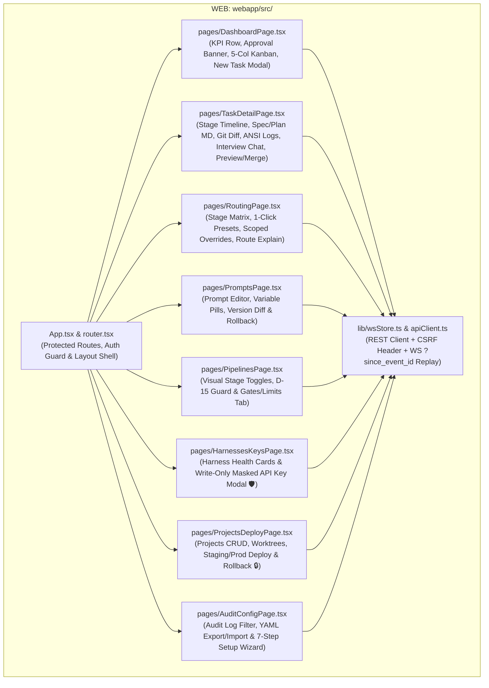
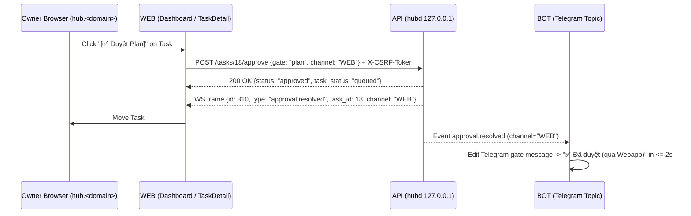
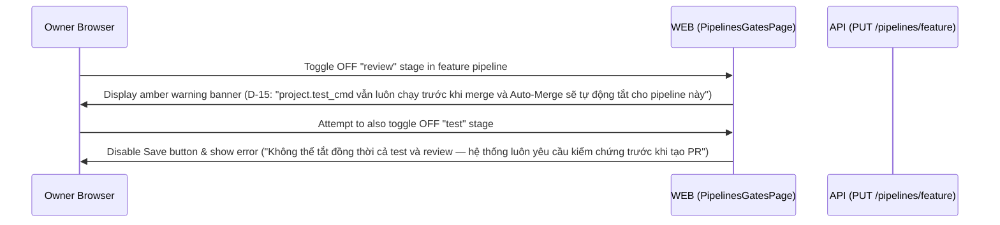

# Module Blueprint: WEB - React + Vite + TypeScript Control Plane SPA

> **Module Code:** `WEB`  
> **Slug:** `webapp` (this file: `docs/plans/modules/webapp.md`)  
> **Code Root:** `webapp/`  
> **Project Roadmap:** `docs/plans/system-roadmap.md#2-module-registry`  
> **Contract Registry:** `docs/plans/contract-registry.md`  
> **Status:** `READY`  
> **Last Updated:** 2026-10-24 15:29  

<!--
STRUCTURE INVARIANTS (checked by scripts/validate-plans.ps1):
- Keep the section heading "## 7. Module Phase Sequence" and its table columns "Phase" and "Status".
- Phase IDs must match <MOD>-P<NN>; statuses: PENDING | ACTIVE | BLOCKED | COMPLETED.
- Every contract ID in §5 and §6 must exist in docs/plans/contract-registry.md.
-->

---

## 1. Module Charter
- **Responsibility:** Provide the rich, responsive visual Control Plane (`React 18 + Vite + TypeScript + Tailwind CSS`) served by `hubd` (`API`) on `127.0.0.1:<hub_port>` and exposed remotely through Cloudflare Tunnel + Cloudflare Access (`https://hub.<domain>`, `D-17`) (`ARCH §3, §12`, `SPEC M4, M5`, `prototype.html`). Enables the owner to monitor all parallel tasks in real time, review diffs/artifacts/logs, answer interview questions, approve gates, and configure every system setting (`FR-48` — Routing, Presets, Prompts, Pipelines `D-15`, Gates & Limits, Harnesses & Keys, Projects, Audit Log, Preview/Deploy, and `/setup` Wizard) without touching YAML files or SSH.
- **In Scope:**
  - **Authentication & CSRF Client Layer (`US-M4-01 🛡`):**
    - Login screen supporting Password + TOTP 2FA and "Gửi Magic Link qua Telegram" (`AC-M4-01.3`), plus seamless pass-through when already authenticated by Cloudflare Access Edge (`CF-Access-Authenticated-User-Email`, `AC-M4-01.2`).
    - Automatic `X-CSRF-Token` header injection on all `POST`/`PUT`/`DELETE` requests (`AC-M4-01.4 🛡`).
  - **Real-Time WebSocket Store & `?since_event_id=` Replay (`US-M4-02`):**
    - Connects to `/ws?since_event_id=<last_seen_id>` (`CT-API-02`), replays missed events on network reconnect, and updates Kanban cards, approval banners, stage timelines, and live log streams within `≤ 2s` without page reload (`AC-M4-02.4`).
  - **M4 Core Screens (`WEB-P01` — matching `prototype.html` & `SPEC M4`):**
    1. **Dashboard & Kanban (`US-M4-02`):** Top KPI cards (Running, Queued, Awaiting Approval, Quota/Rate-Limited, Merged Today), sticky Approval Required Banner with 1-click `[Duyệt]`/`[Xem]`, 5-column Kanban (`Interview & Gate`, `Queued & Blocked`, `Running`, `Review & Test`, `Done / Merged / Failed`), and `+ Tạo Task / Fix / App Mới` modal.
    2. **Task Detail Drawer / View (`US-M4-03`):** Visual Stage Timeline (`interview → spec → plan → code → test → review → pr`), Artifacts viewer (`spec.md` & `plan.md` side-by-side Markdown + version history, accessible even when `/auto on` was used `D-02`), Unified/Split Git Diff viewer with Review Verdict JSON card (`D-07`), Live ANSI Log terminal with stage filter, Interactive Interview Chat box, and Gate Approve/Reject/Merge action bar.
    3. **Model Routing & Presets (`US-M4-04`):** Global stage-to-`harness/model` + fallback matrix, 1-click Presets (`Tiết kiệm / Chỉ Claude`, `Cân bằng`, `Đa Harness tối đa`, `Chỉ Codex`, `DeepSeek Hybrid`), per-project override selector, and interactive Route Explain preview (`US-M3-08`).
    4. **Prompt Management & Versioning (`US-M4-05`):** Stage prompt editor (`interviewer`, `planner`, `coder`, `tester`, `reviewer`, `reporter`) with `{{variable}}` syntax highlighting, side-by-side version diff (`v1 ↔ v2`), and 1-click Rollback (`AC-M4-05.2`).
    5. **Pipelines Editor (`US-M4-06`, `D-15`):** Visual toggle/reorder for `feature`, `fix`, and `new_app` pipelines; displays mandatory warning banner when `test` or `review` stage is toggled off (`D-15`: `project.test_cmd` still runs before merge and auto-merge is disabled) and blocks saving if all verification stages are removed (`AC-M4-06.3`).
    6. **Gates, Auto-Merge & Concurrency Limits (`US-M4-07`):** Global & per-project gate toggles (`spec`, `plan`, `merge`), locked `deploy_prod` toggle (`🔒` permanently enabled with tooltip `AC-M4-07.2`), global & per-model concurrency sliders, and stage timeout inputs.
    7. **Harnesses & API Keys (`US-M4-08 🛡`):** Health cards for `claude`, `codex`, `agy`, `dsh` (`[Kiểm tra lại]` button), OAuth status/expiry badges, and write-only API key modal (`deepseek`, `dashscope`, `openrouter`, `openai`, `anthropic`, `github`, `vercel`, `cloudflare`) that displays only masked suffixes (`sk-****...9a1b`) and never exposes raw keys (`AC-M4-08.2 🛡`).
    8. **Projects Management (`US-M4-09`):** Add/edit/remove projects, inspect detected `test_cmd`, configure `deploy_target`, and view active worktrees with `[Dọn dẹp Worktree]` button.
    9. **Audit Log & Declarative Config Export/Import (`US-M4-10`, `US-M4-11 🛡`):** Filterable security/action audit table (`actor`, `channel`, `action`, `timestamp`) and 1-click `Export hub-config.yaml` / `Import hub-config.yaml` with dry-run diff preview.
  - **M5 Preview, Deploy & Setup Wizard Screens (`WEB-P02`):**
    - Preview URL badge, QR code for mobile testing, countdown TTL timer (`24h`), and `[Tạo Preview]` / `[Tắt Preview]` controls on Task Detail (`US-M5-01..03`).
    - Project Deploy & Rollback panel (`staging` / `prod`) with deployment history, active commit SHA, and mandatory `deploy_prod` confirmation modal (`🔒 US-M5-05, US-M5-06`).
    - 7-step visual `/setup` Onboarding Wizard (`US-M5-07`) with live step validation and resume support.
- **Out of Scope:**
  - Server-side rendering (SSR) or separate Node.js backend server in production (`WEB` compiles to static assets in `webapp/dist/` served directly by `API` `FastAPI` on `127.0.0.1`).
- **Primary Skills (`AI-skill-help.md`):** `frontend-design`, `vercel-react-best-practices`, `web-design-guidelines`, `webapp-testing`, `agent-browser`.

---

## 2. Internal Component Diagram

---

## 3. Public Interface Inventory (Internal to Module)

| Component / Module | File Under `webapp/` | Purpose |
| :--- | :--- | :--- |
| `apiClient` | `webapp/src/lib/apiClient.ts` | Typed `fetch` wrapper against `CT-API-01` (`/api/*`), attaches `X-CSRF-Token` on mutating requests, handles `401` redirect to `/login`. |
| `useHubStreamStore` | `webapp/src/lib/wsStore.ts` | Singleton WebSocket manager (`CT-API-02`) maintaining `lastEventId`, reconnecting with `/ws?since_event_id=<lastEventId>`, and dispatching live updates to task/gate/log stores. |
| `DashboardPage` | `webapp/src/pages/DashboardPage.tsx` | 5-column Kanban board, sticky pending-approval banner, quota status pills, and Task/Fix/New creation modal (`US-M4-02`). |
| `TaskDetailPage` | `webapp/src/pages/TaskDetailPage.tsx` | Stage timeline, `spec.md`/`plan.md` viewer (`D-02`), unified/split diff + review verdict (`D-07`), live log viewer, interview chat, and preview/merge actions (`US-M4-03`, `US-M5-01..03`). |
| `RoutingPage` | `webapp/src/pages/RoutingPage.tsx` | Global & project-scoped model routing table, 1-click presets, and `--explain` resolver preview (`US-M4-04`). |
| `PromptsPage` | `webapp/src/pages/PromptsPage.tsx` | Stage system prompt editor, version history list, side-by-side diff viewer, and rollback trigger (`US-M4-05`). |
| `PipelinesGatesPage` | `webapp/src/pages/PipelinesGatesPage.tsx` | Pipeline stage toggles with `D-15` safety banner, gate switches with locked `deploy_prod` (`🔒`), and concurrency/timeout controls (`US-M4-06`, `US-M4-07`). |
| `HarnessesKeysPage` | `webapp/src/pages/HarnessesKeysPage.tsx` | Harness CLI status/smoke check cards and write-only secret input modal showing only masked suffixes (`US-M4-08 🛡`). |
| `ProjectsDeployPage` | `webapp/src/pages/ProjectsDeployPage.tsx` | Project registry, worktree cleanup, and staging/prod deploy + rollback panel (`US-M4-09`, `US-M5-05`, `US-M5-06`). |
| `SetupWizardModal` | `webapp/src/components/SetupWizardModal.tsx` | 7-step interactive onboarding wizard synchronized with `API` `/setup` state (`US-M5-07`). |

---

## 4. Data Ownership
- **Owned Stores / Tables / Collections:** Client-side in-memory state (`Zustand` / React state) hydrated from `CT-API-01` and synchronized via `CT-API-02`; `sessionStorage` stores only non-sensitive UI preferences (selected theme, split/unified diff mode, `lastSeenEventId`).
- **Read-Only Access:** Never stores raw API keys, tokens, or credentials in `localStorage`, `sessionStorage`, or JS state after form submission (`AC-M4-08.2 🛡`).
- **Retention & Migration Policy:** None.

---

## 5. Contracts Provided
> `WEB` is a top-level user-facing SPA module and provides no inter-module contracts.

| Contract ID | Type | Summary | Spec Path | Consumers |
| :--- | :--- | :--- | :--- | :--- |
| *[None]* | — | — | — | — |

---

## 6. Contracts Consumed

| Contract ID | Provider | Usage in This Module | Failure / Fallback Policy |
| :--- | :--- | :--- | :--- |
| `CT-SYS-01` | `SYS` | Shared TypeScript enum/DTO definitions mirrored from `contracts/openapi/hubd-rest.yaml`. | Build-time TypeScript typecheck (`tsc --noEmit`). |
| `CT-API-01` | `API` | All REST operations (`/auth/*`, `/tasks/*`, `/projects/*`, `/routes/*`, `/prompts/*`, `/pipelines/*`, `/gates/*`, `/secrets/*`, `/audit`, `/config/*`, `/setup`). | Displays toast notification with structured error message from `API`; redirects to login on `401`. |
| `CT-API-02` | `API` | Real-time WebSocket stream (`/ws?since_event_id=<id>`) for Kanban transitions, approval resolution sync, and live container logs. | Shows connection status pill (`🟢 Live` / `🟡 Reconnecting...`) and automatically replays missed events upon reconnect (`AC-M4-02.4`). |

---

## 6b. Key Interaction Flows

### Flow 1: Real-Time Gate Approval from Webapp Syncing to Telegram (`WEB-P01` / `AC-M4-02.3, AC-M2-04.5`)

### Flow 2: Pipeline Stage Toggle with `D-15` Safety Enforcement (`WEB-P01` / `US-M4-06`)

---

## 7. Module Phase Sequence

| Phase | Title | Objective | Aligns to GP | Depends On | Dossier | Status |
| :--- | :--- | :--- | :--- | :--- | :--- | :--- |
| `WEB-P01` | Core React SPA (Auth, Realtime Kanban, Task Detail, Routing, Prompts, Pipelines `D-15`, Gates, Keys & Audit) | Build the Vite + React + TS SPA covering `US-M4-01` → `US-M4-11` (`prototype.html` parity), WebSocket `?since_event_id=` store, CSRF guard, and masked write-only secret inputs (`🛡`) | `GP-04` | `CT-SYS-01`, `CT-API-01`, `CT-API-02`, `API-P04` | — | `PENDING` |
| `WEB-P02` | Preview Controls, Staging/Prod Deploy & Rollback (`deploy_prod` 🔒) & 7-Step `/setup` Wizard | Add Task Detail Preview card (URL, QR code, 24h TTL countdown, `[Tắt Preview]`), Project Staging/Prod Deploy & Rollback UI (`deploy_prod` confirmation modal 🔒), and interactive 7-step `/setup` wizard (`US-M5-01..07`) | `GP-05` | `WEB-P01`, `API-P05` | — | `PENDING` |

---

## 8. Module Invariants & Non-Functional Requirements
- **Performance (`vercel-react-best-practices`):** Initial gzipped JS bundle `< 250 KB`; route-level code splitting (`React.lazy`) for Diff Viewer and Prompt Editor; virtualized log stream container so 10,000+ log lines render at 60fps without freezing the browser tab.
- **Security (`🛡`):**
  - Never stores or renders plaintext secrets; secret inputs use `type="password"` with `autocomplete="off"`, clear state immediately on submit, and only display masked suffixes returned by `API` (`AC-M4-08.2 🛡`).
  - Every mutating request includes `X-CSRF-Token` (`AC-M4-01.4 🛡`).
  - The `deploy_prod` gate toggle is rendered as permanently locked (`checked={true} disabled={true}`) with a lock icon `🔒` (`AC-M4-07.2`).
- **Accessibility & UX (`web-design-guidelines`, `frontend-design`):** Full keyboard navigation (`Esc` closes modals, `Cmd/Ctrl+Enter` submits forms), semantic ARIA roles on Kanban columns, status badges with both color and icon/text labels, and responsive mobile/desktop layout matching `prototype.html`.
- **Testing (`webapp-testing`):** Component & unit tests with `Vitest` + `@testing-library/react`, and E2E browser verification with `Playwright` (`SYS-P05`, `SYS-P06`).

---

## 9. Risks & Open Questions
- **Large Git Diff Rendering on Mobile Browsers:** Task diffs exceeding 2,000 lines are collapsed per-file by default with a `"Xem thêm (+N dòng)"` expander so mobile browsers opening `hub.<domain>` remain snappy.
