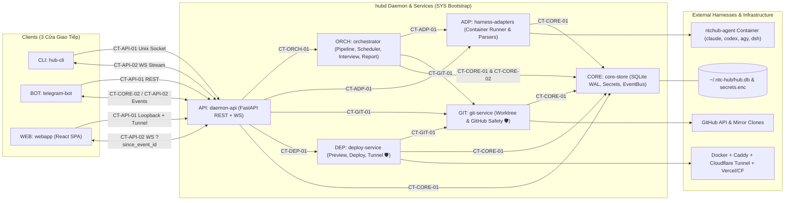
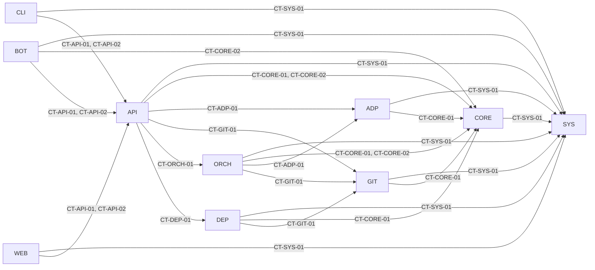

# Project Roadmap: ntc-ai-center-hub

> **Status:** APPROVED  
> **Authority:** Derived from `SPEC.md` (v0.3), `ARCHITECTURE.md`, `PRD.md`, and `AI-skill-help.md`; approved by Human Architect.  
> **Contract Registry:** `docs/plans/contract-registry.md`  
> **Last Synchronized:** 2026-10-24  

<!--
STRUCTURE INVARIANTS (checked by scripts/validate-plans.ps1):
- Keep the section headings "## 2. Module Registry", "## 3. Global Phase Sequence", and "## 5. Active Work Pointer".
- Keep table header names unchanged; wrap codes, slugs, IDs, paths, and statuses in backticks.
- Module status:       PLANNED | BLUEPRINT_REVIEW | READY | IN_PROGRESS | COMPLETED
- Global phase status: PENDING | ACTIVE | COMPLETED
-->

---

## 1. System Architecture Blueprint

### Architectural Invariants
1. **One Brain, Three Thin Doors (`ARCH §1.1`):** All orchestration, state transitions, and safety guards live inside `hubd` (`CORE`, `ADP`, `GIT`, `ORCH`, `DEP`, `API`). `CLI`, `BOT`, and `WEB` are thin clients communicating via `CT-API-01` and `CT-API-02`.
2. **Official Headless CLI Only & Mandatory Container Sandbox (`🛡 FR-15a, AC-M1-05.1..05.3`):** `ADP` invokes harnesses (`claude`, `codex`, `agy`, `dsh`) strictly via official headless CLIs inside ephemeral `ntchub-agent` Docker containers mounting only the task worktree and that single harness's OAuth directory (API keys are injected exclusively into `dsh` containers).
3. **Hardcoded Git & Merge Safety (`🛡 Anti-Goal #1, ARCH §9, US-M1-11`):** Agents never hold GitHub push credentials. `GIT` enforces in code: push only to `^refs/heads/hub/[0-9]+-[a-z0-9-]+$`, no force-push (except `--force-with-lease` on `hubd` rebase), worktree `.git/config` & `.git/hooks` tamper verification, 4-condition PR merge gate, and `D-16` branch lifecycle.
4. **Persist-Before-Side-Effect (`ARCH §1.5, X-02`):** `CORE` commits every state transition (including `TASK.block_reason` ∈ `{'rate_limit', 'auth_expired'}`) to SQLite (`WAL` mode) and `events` before spawning containers, calling GitHub, or sending messages.
5. **Concise & Unbroken Reports (`🛡 Anti-Goal #2, SPEC §2.5, D-13`):** `ORCH` builds reports from structured ground truth and passes long outputs through the §2.5 smart multi-part message splitter (Part 1 ≤ 10 lines with action buttons; Parts 2..5 ≤ 15 lines & ≤ 3,500 chars; zero mid-sentence/code/URL splits).
6. **Zero Public Open Ports (`🛡 D-17, US-M4-01, US-M5-01`):** `API` (`127.0.0.1:<hub_port>` and `~/.ntc-hub/hubd.sock` `0600`) and Caddy (`127.0.0.1:<caddy_port>`) bind loopback only; remote access for `hub.<domain>` and `*.preview.<domain>` runs exclusively through Cloudflare Tunnel + Cloudflare Access (`owner_email` policy).
7. **Contract-First & Single-Module Scope (`AGENTS.md §3`):** Inter-module calls occur only through contracts registered in `docs/plans/contract-registry.md`. Each atomic task modifies only its own module's `Code Root` and activates the designated skills from `AI-skill-help.md`.

### AI Skills Mapping per Module (`AI-skill-help.md`)
| Module | Primary Skills (`.agents/skills/<skill>/SKILL.md`) |
| :--- | :--- |
| `SYS` | `docker-container-security`, `python-testing-patterns`, `felo-search`, `felo-web-fetch`, `felo-superAgent`, `skill-creator` |
| `CORE` | `sqlalchemy-2-async-sqlite`, `python-testing-patterns` |
| `ADP` | `ntchub-harness-adapters`, `docker-container-security`, `python-testing-patterns` |
| `GIT` | `ntchub-git-safety`, `python-testing-patterns` |
| `ORCH` | `ntchub-pipeline-report`, `grill-me`, `skill-creator`, `python-testing-patterns` |
| `DEP` | `cloudflare-tunnel-caddy`, `docker-container-security`, `deploy-to-vercel`, `agent-browser`, `python-testing-patterns` |
| `API` | `python-fastapi-development`, `python-testing-patterns` |
| `CLI` | `python-cli-typer-rich`, `python-testing-patterns` |
| `BOT` | `aiogram-3-telegram-bot`, `ntchub-pipeline-report`, `python-testing-patterns` |
| `WEB` | `frontend-design`, `vercel-react-best-practices`, `web-design-guidelines`, `webapp-testing`, `agent-browser` |

---

## 2. Module Registry

| Code | Slug | Responsibility | Code Root | Blueprint | Depends On | Status |
| :--- | :--- | :--- | :--- | :--- | :--- | :--- |
| `SYS` | `system` | Cross-cutting: shared contracts (`contracts/`), M0 harness spike (`docs/harness-matrix.md`, `scripts/smoke-*.sh`), `ntchub-agent` Docker image, daemon bootstrap, installer & E2E suites | `./` | `docs/plans/modules/system.md` | — | `READY` |
| `CORE` | `core-store` | SQLite WAL persistence (`hub.db`), SQLAlchemy 2.0 async models & Alembic migrations, Persist-Before-Side-Effect state transitions (`block_reason`), encrypted `secrets.enc`, YAML config & in-process `EventBus` | `src/core_store/` | `docs/plans/modules/core-store.md` | `SYS` | `READY` |
| `ADP` | `harness-adapters` | `HarnessAdapter` implementations (`claude`, `agy`, `codex`, `dsh`, `FakeHarness`), isolated `ntchub-agent` container runner, stream-JSON parsers, OAuth/API-key separation & timeout/orphan control | `src/harness_adapters/` | `docs/plans/modules/harness-adapters.md` | `SYS`, `CORE` | `READY` |
| `GIT` | `git-service` | Mirror clones, isolated task worktrees (`hub/<id>-<slug>`), `test_cmd` detector, hardcoded ref/force-push guards (`🛡`), worktree tamper check, GitHub API (repo create, PR, 4-condition merge gate, rebase, `D-16` branch cleanup) | `src/git_service/` | `docs/plans/modules/git-service.md` | `SYS`, `CORE` | `READY` |
| `ORCH` | `orchestrator` | `InterviewService` (1-question/turn, `spec.md`), `Scheduler` (concurrency slots, priority queue, `rate_limit`/`auth_expired` recovery, fallbacks, `repo_summary` cache), YAML `PipelineEngine` (`feature`/`fix`, independent `test_cmd` runner, `ReviewValidator` `D-07`, fix loop `D-08`, crash recovery), `ReportService` & §2.5 `MessageSplitter` (`🛡`) | `src/orchestrator/` | `docs/plans/modules/orchestrator.md` | `SYS`, `CORE`, `ADP`, `GIT` | `READY` |
| `DEP` | `deploy-service` | Preview & Deploy targets (`docker` + Caddy Admin API, `vercel`, `cloudflare`), 24h preview TTL teardown, gated staging/prod deploy (`deploy_prod` 🔒, sequential queue), rollback & Cloudflare Tunnel + Access setup (`D-17`) | `src/deploy_service/` | `docs/plans/modules/deploy-service.md` | `SYS`, `CORE`, `GIT` | `READY` |
| `API` | `daemon-api` | `hubd` FastAPI REST + WebSocket (`/ws?since_event_id=`) server over Unix socket (`~/.ntc-hub/hubd.sock` `0600`) and loopback (`127.0.0.1:<port>`), Webapp session auth (Password+TOTP / Magic Link), CSRF guard & secret masking | `src/daemon_api/` | `docs/plans/modules/daemon-api.md` | `SYS`, `CORE`, `ADP`, `GIT`, `ORCH`, `DEP` | `READY` |
| `CLI` | `hub-cli` | `hub` CLI client (Typer + Rich + Textual) over Unix socket: task/fix/new, terminal interview, live logs (`-f`), `attach` TUI, gates, merge, preview/deploy, config export/import, `setup` & `doctor` | `src/hub_cli/` | `docs/plans/modules/hub-cli.md` | `SYS`, `API` | `READY` |
| `BOT` | `telegram-bot` | `aiogram 3` Forum Topics gateway: `owner_user_id` whitelist (`🛡`), private-chat secret auto-delete ≤ 3s (`🛡`), `#<id> · <slug>` topic lifecycle, inline gate buttons, pinned status edit (`D-10`), multi-part reports (`§2.5`) | `src/telegram_bot/` | `docs/plans/modules/telegram-bot.md` | `SYS`, `CORE`, `API` | `READY` |
| `WEB` | `webapp` | React + Vite + TypeScript SPA served by `hubd`: Dashboard (5-col Kanban, approval banner), Task Detail (timeline, artifacts, diff, live logs, interview chat), Routing & Presets, Prompt versioning, Pipelines (`D-15`), Gates & Limits, Harnesses & Keys, Projects, Audit Log | `webapp/` | `docs/plans/modules/webapp.md` | `SYS`, `API` | `READY` |

---

## 3. Global Phase Sequence

| GP | Title | Objective | Participating Module Phases | Exit Criteria | Status |
| :--- | :--- | :--- | :--- | :--- | :--- |
| `GP-00` | M0 — Spike xác minh Harness CLI | Verify headless flags, non-browser OAuth flows, `dsh` API-key profile, and capture real stream fixtures for `claude`, `codex`, `agy`, `dsh` (`US-M0-01` → `US-M0-03`) | `SYS-P01` | `docs/harness-matrix.md` complete; 4 `scripts/smoke-<harness>.sh` green inside `ntchub-agent`; fixtures saved in `tests/fixtures/<harness>/` | `ACTIVE` |
| `GP-01` | M1 — Lõi (`hubd` + CLI + Git Safety + Pipeline `task`/`fix`) | End-to-end `task`/`fix` on existing repos via `hub` CLI, container-isolated `claude` + `agy` adapters, independent `test_cmd` verification, structured review, and hardcoded Git safety (`US-M1-01` → `US-M1-16`) | `SYS-P02`, `CORE-P01`, `ADP-P01`, `GIT-P01`, `ORCH-P01`, `API-P01`, `CLI-P01` | Demo `hub task` & `hub fix` opening green PRs and merging via `hub merge`; all M1 `🛡` security & splitter unit/integration tests green; 3 parallel tasks run without hanging | `PENDING` |
| `GP-02` | M2 — Telegram Forum Topics Gateway | Full remote control from phone via Telegram group with Topics, 1-question/turn interview, inline approval buttons, pinned status edits, and private-chat secret auto-deletion (`US-M2-01` → `US-M2-10`) | `CORE-P02`, `ORCH-P02`, `API-P02`, `BOT-P01`, `SYS-P03` | J2, J3, J4 completed 100% from phone; CLI ↔ Telegram gate sync ≤ 3s; non-owner messages ignored (`🛡`); private chat secrets deleted in ≤ 3s (`🛡`) | `PENDING` |
| `GP-03` | M3 — App mới (`/new`) + Codex + DeepSeek Harness + Quota | New app repo creation (`J1`), `CodexAdapter`, `DeepSeekHarnessAdapter` (`dsh` API keys), route fallbacks, `rate_limit`/`auth_expired` auto-recovery, per-model concurrency limits, and `repo_summary` cache (`US-M3-01` → `US-M3-09`) | `ADP-P02`, `GIT-P02`, `ORCH-P03`, `API-P03`, `CLI-P02`, `BOT-P02`, `SYS-P04` | Demo `/new` creating private repo + PR to merge; simulated rate-limit/auth-expiry triggers fallback or `block_reason` recovery; both single-harness and multi-harness presets pass | `PENDING` |
| `GP-04` | M4 — Webapp SPA & Cloudflare Tunnel Access | React SPA served on `127.0.0.1` behind Cloudflare Tunnel + Access (`hub.<domain>`), realtime Dashboard, Task Detail, Routing/Prompt/Pipeline/Gate/Project editors, and YAML config export/import (`US-M4-01` → `US-M4-11`) | `CORE-P03`, `ORCH-P04`, `DEP-P01`, `API-P04`, `CLI-P03`, `WEB-P01`, `SYS-P05` | All FR-48 settings editable in Webapp; Webapp gate approval syncs to Telegram; unauthenticated requests blocked at Cloudflare Access Edge (`🛡`) | `PENDING` |
| `GP-05` | M5 — Preview, Deploy & Setup Đầy Đủ | Preview deployments (`docker` + Caddy `*.preview.<domain>` behind Cloudflare Access, `vercel`, `cloudflare`), 24h TTL teardown, gated staging/prod deploy (`deploy_prod` 🔒) & rollback, and multi-channel `/setup` wizard (`US-M5-01` → `US-M5-07`) | `DEP-P02`, `API-P05`, `CLI-P04`, `BOT-P03`, `WEB-P02`, `SYS-P06` | Full J1 demo through `/preview` on phone → `/merge` → `/deploy prod` → `/rollback`; zero public open ports on VPS besides SSH (`🛡`); fresh setup works via `/setup` | `PENDING` |

---

## 4. Module Dependency Graph

**Recommended build order:** `SYS` → `CORE` → (`ADP`, `GIT`) → (`ORCH`, `DEP`) → `API` → (`CLI`, `BOT`, `WEB`).

---

## 5. Active Work Pointer
<!-- AGENT INVARIANT: update whenever the current stage or focus changes. The table MUST match docs/plans/active/ exactly. -->
- **Current Stage:** Gate 3 Completed (All 10 Module Blueprints `READY` — Awaiting Gate 4 instruction for `SYS-P01`)
- **Current Focus:** `SYS` → `SYS-P01` (`GP-00: M0 — Spike xác minh Harness CLI`)
- **Planning Item In Review (Gate 2/3 only):** `None (Gate 1–3 APPROVED)`

| Module | Active Dossier | Lifecycle Status |
| :--- | :--- | :--- |
| *[None]* | | |
